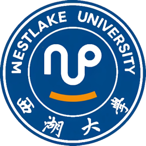
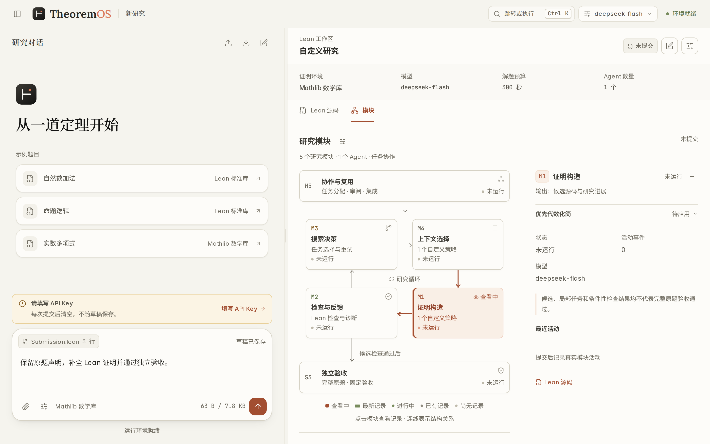
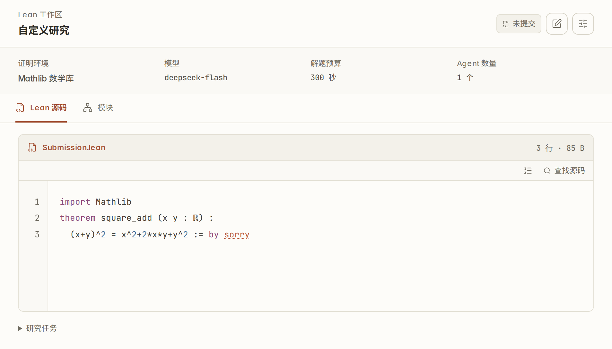
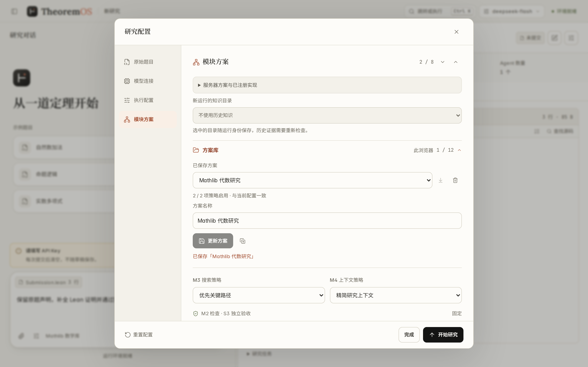

<div align="center">
  <p>简体中文 · <a href="./README_EN.md" lang="en">English</a></p>
  <picture>
    <source media="(prefers-color-scheme: dark)" srcset="./docs/assets/readme-mark-dark.svg">
    <source media="(prefers-color-scheme: light)" srcset="./docs/assets/readme-mark.svg">
    
  </picture>
  <h1>TheoremOS</h1>
  <p><strong>人机协同的 Lean 4 数学研究工作台与模块化可编程运行时</strong></p>
  <p>
    由<a href="https://www.westlake.edu.cn/">西湖大学</a>
    <a href="https://westlakenlp.com/"> <strong>WestlakeNLP 实验室</strong></a>（自然语言处理实验室）开源研发
  </p>
  <p>
    <a href="https://github.com/HuggingMath/theorem-os"><strong>⭐ 点赞收藏</strong></a> ·
    <a href="https://app.theoremos.top/">在线工作台</a> ·
    <a href="https://theoremos.top/">产品官网</a> ·
    <a href="https://github.com/HuggingMath/TheoremOS">公开证明档案</a> ·
    <a href="./docs/usage.md">运行指南</a> ·
    <a href="./docs/solver-modules.md">研究组件 (M1–M5)</a> ·
    <a href="./CITATION.cff">引用本项目</a>
  </p>
  <p>
    <a href="https://github.com/HuggingMath/theorem-os"></a>
    <a href="https://westlakenlp.com/"></a>
    <a href="./docs/releases/v0.1.0.md"></a>
    <a href="https://github.com/HuggingMath/theorem-os/actions/workflows/verify.yml"></a>
    <a href="./examples/getting-started/README.md"></a>
    <a href="./LICENSE"></a>
  </p>
  <br>
  <a href="https://app.theoremos.top/">
    
  </a>
</div>

**TheoremOS** 是一套面向前沿数学与形式化推理的**人机协同 Lean 4 研究系统**，包含完整开源的[网页研究工作台](./docs/web-workbench.md)、命令行求解器（`bun run math` / `theorem-os`）、独立的 Lean 内核验收运行时（`S1` 档案与 `S3` 终验），以及可逐个替换的 **M1–M5 研究决策组件**。

> [!TIP]
> **觉得这个开源研究底座有帮助？** 欢迎点击右上角给 [**HuggingMath/theorem-os**](https://github.com/HuggingMath/theorem-os)（以及我们的公开证明档案与官网仓库 [**HuggingMath/TheoremOS**](https://github.com/HuggingMath/TheoremOS)）点亮 **⭐ Star**！你的支持能帮助更多数学与 AI4Science 研究者发现本项目，并持续追踪 [WestlakeNLP](https://westlakenlp.com/) 的后续研究进展。

### 核心亮点

| 网页工作台与人机协同 | 零信任独立 Lean 验收 (`S1` / `S3`) | M1–M5 可替换策略与实验对比 |
| :--- | :--- | :--- |
| 内置 [`apps/web`](./apps/web/) 科研工作台，支持自然语言、TeX 与单文件 Lean 输入、后台语义审查、共同推进/自动推进模式与实时 Lean 反馈视图。 | 模型输出“已完成”或局部引理通过**从不替代最终验收**；[`evaluation.ts`](./src/solver/evaluation.ts) 固定完整原题与环境独立重验，[`archive.ts`](./src/solver/archive.ts) 完整保留每轮尝试、报错与用量以便断点续跑。 | 将证明构造、检查反馈、搜索调度、上下文筛选与协作分工拆分为 5 个带版本的 TypeScript 组件，可在不改宿主运行时和验收规则的前提下开展对照消融实验。 |

| 仓库 | 定位与内容 | 许可证 |
| --- | --- | --- |
| [**HuggingMath/theorem-os**](https://github.com/HuggingMath/theorem-os)（本仓库） | 开源网页工作台、命令行工具（`bun run math`）、M1–M5 核心运行时与测试 | [`AGPL-3.0-only`](./LICENSE) |
| [**HuggingMath/TheoremOS**](https://github.com/HuggingMath/TheoremOS) | [产品官网](https://theoremos.top/)、29 条公开证明档案、Dimitrov 独立复核包与双语指南 | [Rights reserved](https://github.com/HuggingMath/TheoremOS/blob/main/LICENSE) |

---

## 快速开始

| 你想做什么 | 推荐入口 | 需要准备 |
| --- | --- | --- |
| **免密钥体验独立 Lean 验收闭环** | [小题示例与回放](./examples/getting-started/README.md) | Linux、Bun 1.2+、Lean 4.33.0（无需模型 API Key） |
| **使用在线云端工作台** | [在线工作台](https://app.theoremos.top/) · [申请内测](https://github.com/HuggingMath/TheoremOS/issues/new?template=early-access.yml) | 白名单邮箱与支持 Responses API 的模型 Key |
| **本地 Docker Compose 自部署网页工作台** | [工作台部署指南](./docs/web-workbench.md) · [`compose.yml`](./apps/web/compose.yml) | Linux、Docker Compose、`/dev/fuse`（完整 Mathlib 环境） |
| **替换 M1–M5 研究策略并跑基准对比** | [组件替换示例](./examples/components/README.md) · [IMO2026 示例](./examples/imo2026/README.md) | Codex CLI、Elan/Lean、Bubblewrap 与 FUSE |

### 1. 五条命令本地体验预设验收回放（无需模型 API Key）

从 GitHub 克隆后安装依赖并准备示例所需的 Lean 工具链（只需标准库，无需下载 Mathlib）：

```bash
git clone https://github.com/HuggingMath/theorem-os.git && cd theorem-os
bun install --frozen-lockfile
elan toolchain install leanprover/lean4:v4.33.0

export THEOREMOS_REPLAY="$PWD/../theorem-os-runs/first-replay"
bun run math doctor --lean-only
bun run math example replay --dir "$THEOREMOS_REPLAY"
bun run math inspect --run "$THEOREMOS_REPLAY/result.json"
```

回放会在本机真实构建并运行宿主检查流程：先提交故意失败的候选并接收 Lean 报错，再用 `Nat.zero_add` 修复并由独立内核验收输出 `evaluated_passed`（`modelInvoked: false`、`official: false`）。准备好模型凭据后，可按 [运行指南](./docs/usage.md) 运行 `bun run math example prepare / check / resume`。

<details>
<summary><b>2. 使用 Docker Compose 或 GHCR 镜像本地自部署网页工作台</b></summary>

完整依赖与 FUSE / 磁盘要求（建议为每个并发 Mathlib 任务预留 30 GiB 可用磁盘）详见 [网页工作台文档](./docs/web-workbench.md) 与[运维指南](./docs/web-operations.md)：

```bash
# 方式 A：从当前源码构建 web 与 worker 镜像并启动
THEOREMOS_SOURCE_COMMIT=$(git rev-parse HEAD) docker compose -f apps/web/compose.yml build worker web
docker compose -f apps/web/compose.yml up -d web
docker compose -f apps/web/compose.yml ps

# 方式 B：拉取 GitHub Actions 发布到 GHCR 的完整 SHA 镜像对
export THEOREMOS_IMAGE_TAG=<完整的40位提交SHA>
docker compose -f apps/web/compose.yml -f apps/web/compose.ghcr.yml pull worker web
bun scripts/web-operations.ts images --commit "$THEOREMOS_IMAGE_TAG"
docker compose -f apps/web/compose.yml -f apps/web/compose.ghcr.yml up -d --no-build web
```

</details>

<details>
<summary><b>3. 生成并验证自定义研究组件（M1–M5）</b></summary>

可在不改动宿主运行时或 `S3` 验收规则的前提下，生成自定义 `SolverModules` 模板并运行本地静态/排序校验（见 [组件替换示例](./examples/components/README.md)）：

```bash
bun run math component init --name my-search
bun run math component check --name my-search

export THEOREMOS_COMPONENT_CASE="$PWD/../theorem-os-runs/my-search"
bun run math example prepare --dir "$THEOREMOS_COMPONENT_CASE" --component my-search --workers 3
bun run math example check --dir "$THEOREMOS_COMPONENT_CASE"
bun run math example resume --dir "$THEOREMOS_COMPONENT_CASE"
```

</details>

---

## 工作台界面与研究架构展示

<table width="100%">
  <tr>
    <td width="50%" align="center" valign="middle">
      <a href="./docs/assets/workbench-modules-desktop.png"></a>
    </td>
    <td width="50%" align="center" valign="middle">
      <a href="./docs/assets/workbench-source-detail.png"></a>
    </td>
  </tr>
  <tr>
    <td width="50%" align="center" valign="top">
      <sub><strong>研究循环图谱</strong> — M1–M5 决策边界与 S3 独立最终验收解耦（<a href="./docs/assets/workbench-modules-desktop-en.png">EN</a>）。</sub>
    </td>
    <td width="50%" align="center" valign="top">
      <sub><strong>Lean 实时工作区</strong> — 按题隔离环境、依赖导入与编译器诊断一目了然（<a href="./docs/assets/workbench-source-detail-en.png">EN</a>）。</sub>
    </td>
  </tr>
</table>

<details>
<summary><b>查看更多界面截图与本地验收回放示例</b></summary>
<br>
<table width="100%">
  <tr>
    <td width="50%" align="center" valign="middle">
      <a href="./docs/assets/replay.png"></a>
    </td>
    <td width="50%" align="center" valign="middle">
      <a href="./docs/assets/workbench-library-desktop.png"></a>
    </td>
  </tr>
  <tr>
    <td width="50%" align="center" valign="top">
      <sub><strong>预设回放结果</strong> — 无模型调用展示 <code>evaluated_passed</code> 与零 <code>sorry</code> 检查输出。</sub>
    </td>
    <td width="50%" align="center" valign="top">
      <sub><strong>研究方案库</strong> — 浏览器内保存、切换、导入或导出自定义研究配置（<a href="./docs/assets/workbench-library-desktop-en.png">EN</a>）。</sub>
    </td>
  </tr>
</table>
</details>

---

## 五个可替换研究组件与核心文档

系统将“策略决策”与“结果验收”严格隔离（完整契约见 [`docs/solver-modules.md`](./docs/solver-modules.md) 与 [`src/solver/modules/index.ts`](./src/solver/modules/index.ts)）：

| 组件 / 层级 | 核心职责 | 实现入口 | 文档与示例 |
| --- | --- | --- | --- |
| **M1 · 执行** | 在隔离工作区执行模型对话、候选生成与笔记记录 | [`execution.ts`](./src/solver/modules/execution.ts) | [组件合约](./examples/components/README.md) |
| **M2 · 证据** | 绑定 commit 与声明身份，执行 Lean 候选检查与诊断反馈 | [`evidence.ts`](./src/solver/modules/evidence.ts) | [形式化检查](./docs/formalization.md) |
| **M3 · 搜索调度** | 选择下一步操作、就绪任务排序与可恢复重试策略 | [`search.ts`](./src/solver/modules/search.ts) | [M3 替换示例](./examples/components/README.md) |
| **M4 · 上下文选择** | 为模型轮次按版本和预算组装精确的题目、依赖与约束信息 | [`context.ts`](./src/solver/modules/context.ts) | [恢复与检查点](./docs/recovery.md) |
| **M5 · 职责分配** | 向协作角色、Engineer 与独立审阅者分派研究与验证任务 | [`organization.ts`](./src/solver/modules/organization.ts) | [模块边界说明](./docs/solver-modules.md) |
| **S1 / S3 · 宿主验收** | 归档完整过程状态，并在洁净环境里按原始完整原题重验（不可被研究策略跳过） | [`archive.ts`](./src/solver/archive.ts) · [`evaluation.ts`](./src/solver/evaluation.ts) | [运行指南](./docs/usage.md) |

---

## 独立验收与公开实验记录

> [!NOTE]
> 以下公开记录均明确区分**官方托管验收**（`official: true`）与**本地独立 Lean 内核核验**（`official: false`）；选定成功链或早期试用反馈均不能外推为当前系统的零样本通过率。

- **IMO2026 公开对比（`6/6` 题目 / `15/15` 目标）**：在对齐的 AxiomMath 形式化题面下完成全部 6 题（`TheoremOS + GPT-5.6` 合计 **285.55 分钟**，本地独立 Lean 内核验收 `official: false`），完整记录与统计口径说明见 [`examples/imo2026/RESULTS.md`](./examples/imo2026/RESULTS.md) 与 [IMO2026 复现指引](./examples/imo2026/README.md)。
- **Lean-Eval 与扩展基准**：公开提交归档与源码哈希记录见 [`accepted/accepted.json`](./accepted/accepted.json)、[`submitted/README.md`](./submitted/README.md)、[PutnamBench 示例](./examples/putnambench/README.md) 与 [First Proof 示例](./examples/first-proof/README.md)，完整浏览请访问 [**HuggingMath/TheoremOS**](https://github.com/HuggingMath/TheoremOS) 与 [**theoremos.top/archive.html**](https://theoremos.top/archive.html)。
- **工作台文档与试用记录**：[自然语言形式化](./docs/formalization.md) · [非形式化讲解](./docs/informalization.md) · [站点发布架构](./docs/website.md) · [首轮试用记录](./docs/web-release-trial.md) · [v0.1.0 发布说明](./docs/releases/v0.1.0.md)

---

## 关于 WestlakeNLP

<table width="100%">
  <tr>
    <td width="124" align="center" valign="middle">
      <a href="https://westlakenlp.com/">
        
      </a>
    </td>
    <td valign="middle">
      TheoremOS 由<a href="https://www.westlake.edu.cn/">西湖大学</a> <a href="https://westlakenlp.com/"><strong>WestlakeNLP 实验室</strong></a>（自然语言处理实验室，2018 年成立，由<a href="https://en.westlake.edu.cn/faculty/nlp/yue-zhang.html">张岳教授</a>领导）研发。实验室围绕自然语言处理、大模型推理与 AI for Science 开展基础与应用研究，致力于探索辅助自然科学与人文社科发现的智能系统。
      <br><br>
      <strong>实验室官网：</strong><a href="https://westlakenlp.com/">westlakenlp.com</a> ·
      <strong>X (Twitter)：</strong><a href="https://x.com/NlpWestlake">@NlpWestlake</a> ·
      <strong>联系邮箱：</strong><a href="mailto:liuzhenhao@westlake.edu.cn">liuzhenhao@westlake.edu.cn</a>
    </td>
  </tr>
</table>

---

## 许可证、致谢与引用

- 本仓库自有源代码默认采用 **[AGPL-3.0-only](./LICENSE)** 许可；具体范围说明、第三方组件、字体、内置 Lean 库（44 个上游模块）、改编自 [DeepScientist](https://github.com/ResearAI/DeepScientist)（及其含有的 `Apache-2.0` 文件与 [AionUi](https://github.com/iOfficeAI/AionUi) 源流）、[LeanAide](https://github.com/zhangir-azerbayev/LeanAide)、[autoform-bot](https://github.com/reaslab/autoform-bot)、Codex 后端及基准题面各自保留的许可声明，均完整记录于 **[NOTICE](./NOTICE)**。
- 学术研究、实验对照或工程二次开发使用 TheoremOS 时，请参照 **[CITATION.cff](./CITATION.cff)** 引用本项目（建议附上使用的 release 标签或 commit），并按各自条款署名所涉及的第三方软件、数学题目及证明作者。

<details>
<summary><b>引用 TheoremOS（BibTeX）</b></summary>

```bibtex
@software{liu2026theoremos,
  author  = {Liu, Zhenhao},
  title   = {TheoremOS},
  version = {0.1.0},
  year    = {2026},
  month   = nov,
  note    = {WestlakeNLP, Westlake University},
  url     = {https://github.com/HuggingMath/theorem-os}
}
```

</details>

---

## 支持与社区参与

- **⭐ Star 支持两个仓库** — 给本仓库 [**HuggingMath/theorem-os**](https://github.com/HuggingMath/theorem-os) 点星追踪工作台、CLI 与 M1–M5 运行时更新；同时关注 [**HuggingMath/TheoremOS**](https://github.com/HuggingMath/TheoremOS) 收藏 29 条公开证明档案与独立复核包。
- **💬 反馈问题与共建** — 欢迎提交 Pull Request 改进研究策略模块或工具链支持，或在 [Issues / 反馈中心](https://github.com/HuggingMath/TheoremOS/issues/new/choose) 交流本地复现与功能建议。
- **🤝 学术合作** — 关注 [@NlpWestlake](https://x.com/NlpWestlake)，或发信至 [liuzhenhao@westlake.edu.cn](mailto:liuzhenhao@westlake.edu.cn) 讨论多文件 Lake 工程接入、自定义工具链与联合评测。

<p align="center">
  <a href="https://github.com/HuggingMath/theorem-os"><b>⭐ Star theorem-os</b></a> ·
  <a href="https://github.com/HuggingMath/TheoremOS"><b>⭐ Star TheoremOS</b></a> ·
  <a href="https://app.theoremos.top/"><b>体验在线工作台</b></a> ·
  <a href="https://github.com/HuggingMath/TheoremOS/issues/new/choose"><b>提交反馈 / Issue</b></a>
</p>
