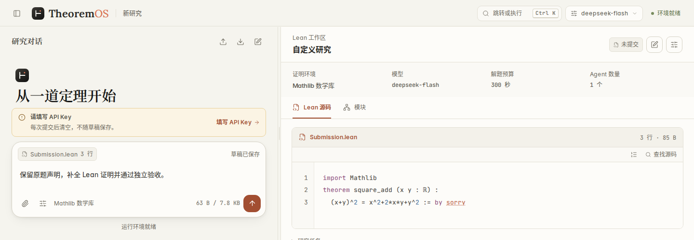

<!-- README_SYNC: source=2cbe72f0cfde; updated=2026-11-18 -->
<p align="center">简体中文 · <a href="./README_EN.md">English</a></p>

<div align="center">
  
  <h1>TheoremOS</h1>
  <p><strong>从自然语言原题出发，构造并独立核验 Lean 证明。</strong></p>
  <p><a href="https://theoremos.top/">产品官网</a> · <a href="https://app.theoremos.top/">在线工作台</a> · <a href="https://theoremos.top/archive.html">公开证明档案</a></p>
</div>

[](./docs/web-workbench.md)
[](./LICENSE)



本仓库包含 TheoremOS 的工作台与 CLI。输入自然语言、TeX 或 Lean 题面后，可以查看生成的 Lean 陈述、候选证明和诊断，再下载证明及验收报告。研究者可在同一验收规则下比较不同的检索、上下文和协作策略。[TheoremOS 官网仓库](https://github.com/HuggingMath/TheoremOS)提供官网源码、公开证明档案和本地复核材料。两仓库各有自己的许可证。

## 快速开始

| 你想做什么 | 从哪里开始 | 需要准备 |
| --- | --- | --- |
| 在线看例题、回放或证明 | [工作台](https://app.theoremos.top/) · [公开档案](https://theoremos.top/archive.html) | 浏览器；登录工作台需获准邮箱 |
| 用自己的题目开始研究 | [工作台指南](./docs/web-workbench.md) | 获准邮箱、所选模型服务的 API Key |
| 在本机核验一次预设回放 | [小题示例](./examples/getting-started/README.md) | 本机 Lean；无需模型 Key |
| 维护部署或替换研究组件 | [运行指南](./docs/usage.md) · [组件示例](./examples/components/README.md) | 本地运行环境；模型调用另需认证 |

工作台采用白名单 Beta，[官网](https://theoremos.top/)提供申请入口。提交前请设置模型和所需的预算限制；空白限制不生效，模型调用由服务商计费。Lean 能检查给定陈述的证明，原意是否准确仍应由研究者复核。编译通过后可以先查看陈述，后台语义审核单独提供意见。

<a id="快速体验"></a>

### 预设 Lean 回放

在仓库根目录执行。需要 Linux、Git、Bun 1.2+、Node.js 22+、系统 Python、util-linux、Elan，以及允许用户命名空间的 Bubblewrap。回放只用 Lean 标准库，不需要 Mathlib 或 FUSE。

```bash
bun install --frozen-lockfile
elan toolchain install leanprover/lean4:v4.33.0
bun run math doctor --lean-only
export THEOREMOS_CASE="$PWD/../theorem-os-runs/first-replay"
bun run math example replay --dir "$THEOREMOS_CASE"
bun run math inspect --run "$THEOREMOS_CASE/result.json"
```

为新回放选择未使用的目录。候选证明是预设的，Lean 检查实际执行。[运行指南](./docs/usage.md)说明如何准备、检查与恢复模型运行。

### 部署网页工作台

自行部署需要 Linux、Docker Compose 和用户命名空间支持；运行 Mathlib 任务还需要 `/dev/fuse`。

```bash
git clone https://github.com/HuggingMath/theorem-os.git
cd theorem-os
docker compose -f apps/web/compose.yml build worker web
docker compose -f apps/web/compose.yml up -d web
```

访问 <http://127.0.0.1:8787>。[部署指南](./docs/web-workbench.md)覆盖资源限制、数据保存、模型服务与 Key 配置；[发布状态](./docs/web-release-status.md)列出已验证的工作台范围。CLI 可以独立运行。

## 验证与结果

运行先冻结原题声明和依赖。候选证明可以多次检查和修订，集成后再交给独立验收。`result.json` 中的 `evaluated_passed` 表示该次运行通过最终检查。局部检查、审阅意见和 Agent 的完成消息各有自己的含义。

| 记录 | 如何解读 |
| --- | --- |
| [Lean-Eval 早期成果](./accepted/README.md) · [提交档案](./submitted/README.md) | 保留官方结果链接、证明来源和复核材料。部分成果来自前身 DeepScientist Math 或沿用早期证明，不能用来推算当前系统从零求解的成功率。 |
| [IMO2026 本地结果](./examples/imo2026/RESULTS.md) · [对照实验](./examples/imo2026/COMPARISON.md) | 逐题保存 Lean 验收、形式化题面和计时口径。各方的模型、预算和计时方式不同。 |
| [OpenAI math 本地记录](./results/openai-math/README.md) | 分开记录证明、原比较器和系统验收；没有 OpenAI 托管验收。 |

## 五个可替换组件

M1 在隔离工作区执行，M2 返回 Lean 证据，M3 选择就绪任务，M4 组装原题、已知结果和反馈，M5 分配研究与审阅职责。运行时保存组件版本，恢复时核对；研究组件与最终验收分开。当前使用 TypeScript 源码接口，尚无稳定插件 SDK。

- [组件与交接协议](./docs/solver-modules.md) · [TypeScript 接口](./src/solver/modules/index.ts) · [独立验收入口](./src/solver/evaluation.ts)
- [形式化](./docs/formalization.md) · [证明讲解](./docs/informalization.md) · [定理索引](./docs/theorem-knowledge.md)
- [数学工具目录、配置与示例](./docs/math-tools/README.md)
- [项目与维护文档](./docs/README.md)

## 许可证与致谢

TheoremOS 自有源码采用 [AGPL-3.0-only](./LICENSE)。[授权范围](./LICENSES/project-scope.md)列出保留原署名的贡献；Web 数学库的 [44 个上游 Lean 模块及其适配版本](./resources/theorem-os-library/REDISTRIBUTION.md)按同一许可证单独授权。题目、论文、数据和第三方组件保留各自条款，见 [NOTICE](./NOTICE) 和相应目录的说明。

在论文、报告或演示中使用 TheoremOS 时，建议按 [CITATION.cff](./CITATION.cff) 引用，并注明所用版本或提交。题目、数据和第三方软件请分别注明原作者与出处。独立修改版请说明与官方版本的关系，避免被误认为官方发布或得到上游背书。

感谢 [Lean](https://lean-lang.org/)、[Mathlib](https://github.com/leanprover-community/mathlib4) 和 [Lean-Eval](https://github.com/leanprover/lean-eval) 提供工具与评测资源。
