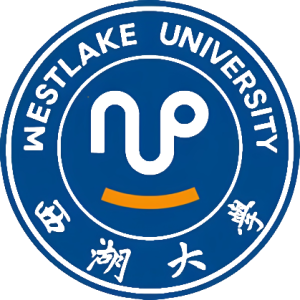
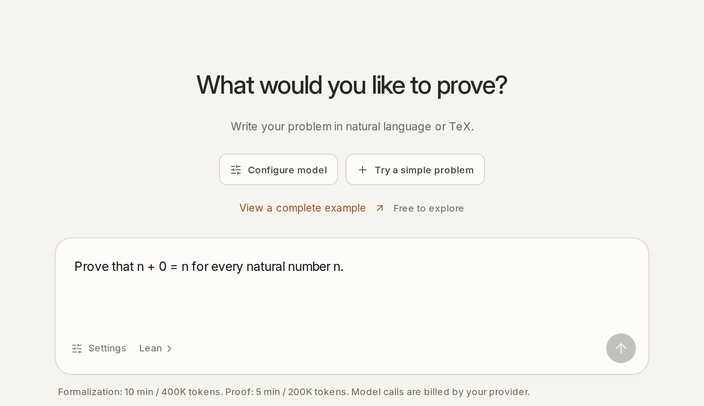
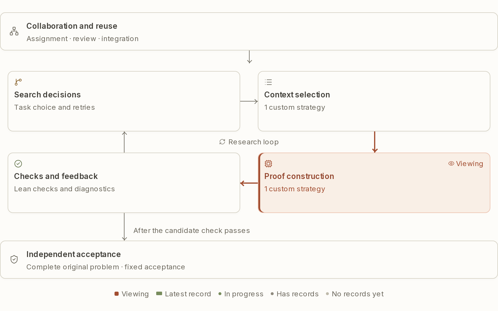
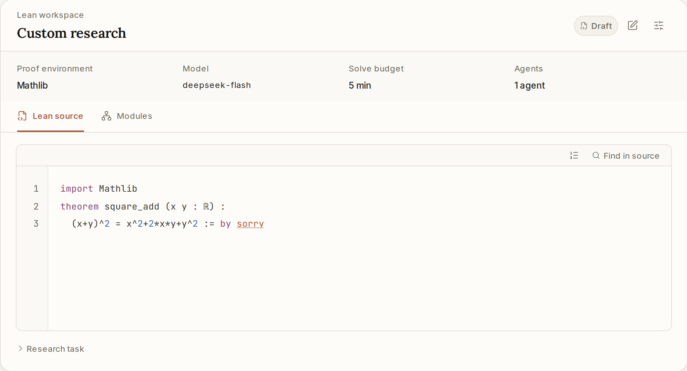
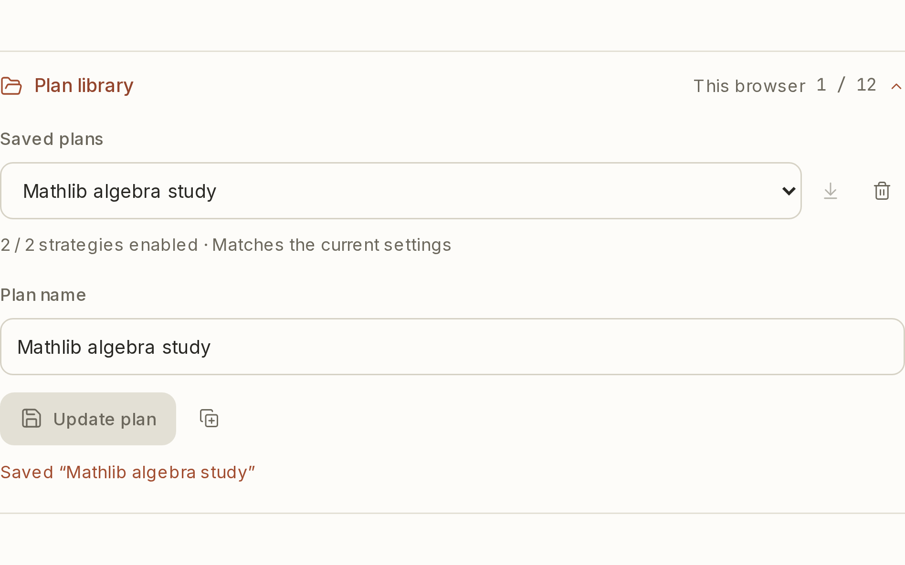

<div align="center">
  <p>English · <a href="./README.md" lang="zh-CN">简体中文</a></p>
  <picture>
    <source media="(prefers-color-scheme: dark)" srcset="./docs/assets/readme-mark-dark.svg">
    <source media="(prefers-color-scheme: light)" srcset="./docs/assets/readme-mark.svg">
    
  </picture>
  <h1>TheoremOS</h1>
  <p><strong>Open-Source Collaborative Lean 4 Mathematical Research Workbench &amp; Modular Runtime</strong></p>
  <p>
    Developed at
    <a href="https://westlakenlp.com/"> <strong>WestlakeNLP</strong></a>
    (Natural Language Processing Lab, <a href="https://en.westlake.edu.cn/">Westlake University</a>)
  </p>
  <p>
    <a href="https://github.com/HuggingMath/theorem-os"><strong>⭐ Star</strong></a> ·
    <a href="https://app.theoremos.top/">Cloud Workbench</a> ·
    <a href="https://theoremos.top/en/">Website</a> ·
    <a href="https://github.com/HuggingMath/TheoremOS">Proof Archive Repo</a> ·
    <a href="./docs/usage.md">Usage Guide</a> ·
    <a href="./docs/solver-modules.md">Modules (M1–M5)</a> ·
    <a href="./CITATION.cff">Cite</a>
  </p>
  <p>
    <a href="https://github.com/HuggingMath/theorem-os"></a>
    <a href="https://westlakenlp.com/"></a>
    <a href="./docs/releases/v0.1.0.md"></a>
    <a href="https://github.com/HuggingMath/theorem-os/actions/workflows/verify.yml"></a>
    <a href="./examples/getting-started/README.md"></a>
    <a href="./LICENSE"></a>
  </p>
  <br>
  <a href="https://app.theoremos.top/">
    
  </a>
</div>

**TheoremOS** is an open-source **collaborative Lean 4 mathematical research workbench and modular agent runtime** (`AGPL-3.0-only`). It brings together the browser workbench ([`apps/web`](./apps/web/)), a reproducible CLI runner (`bun run math` / `theorem-os`), zero-trust final Lean kernel acceptance (`S1` archives &amp; `S3` verification), and five swappable research policy modules (**M1–M5**).

> [!TIP]
> **Finding TheoremOS helpful for your work?** Please give [**HuggingMath/theorem-os**](https://github.com/HuggingMath/theorem-os) (alongside our proof archive and product site repository [**HuggingMath/TheoremOS**](https://github.com/HuggingMath/TheoremOS)) a **⭐ Star** to help fellow mathematicians and AI-for-Math researchers discover the project and follow updates from [WestlakeNLP](https://westlakenlp.com/).

### Why TheoremOS?

| Web Workbench &amp; Human Control | Zero-Trust Acceptance (`S1` / `S3`) | Replaceable M1–M5 Modules |
| :--- | :--- | :--- |
| Built-in [`apps/web`](./apps/web/) UI supporting natural language, TeX, or single-file Lean input, background semantic review, cooperative/autonomous modes, and live Lean diagnostics. | A model claiming completion or local helper passes **never counts as theorem acceptance**; [`evaluation.ts`](./src/solver/evaluation.ts) re-verifies the frozen original problem cleanly, while [`archive.ts`](./src/solver/archive.ts) checkpoints every attempt for pause and resume. | Decouples proof construction, evidence checks, search scheduling, context assembly, and role assignment into versioned TypeScript interfaces for controlled ablation studies under identical problems and acceptance checks. |

| Repository | Scope &amp; Contents | License |
| --- | --- | --- |
| [**HuggingMath/theorem-os**](https://github.com/HuggingMath/theorem-os) *(this repo)* | Open-source web workbench, CLI runner (`bun run math`), M1–M5 modules, and test suite | [`AGPL-3.0-only`](./LICENSE) |
| [**HuggingMath/TheoremOS**](https://github.com/HuggingMath/TheoremOS) | [Product website](https://theoremos.top/en/), 29 archived proof records, Dimitrov proof kit &amp; bilingual guides | [Rights reserved](https://github.com/HuggingMath/TheoremOS/blob/main/LICENSE) |

---

## Quick Start

| What you want to do | Where to start | Requirements |
| --- | --- | --- |
| **Replay local Lean verification (no API key)** | [Getting-Started Example](./examples/getting-started/README.md) | Linux, Bun 1.2+, Lean 4.33.0 (stdlib only; zero LLM calls) |
| **Try the hosted cloud workbench** | [Cloud Workbench](https://app.theoremos.top/) · [Request Access](https://github.com/HuggingMath/TheoremOS/issues/new?template=early-access.yml) | Allowlisted email &amp; Responses API key |
| **Self-host the workbench via Docker Compose** | [Workbench Deployment Guide](./docs/web-workbench.md) · [`compose.yml`](./apps/web/compose.yml) | Linux, Docker Compose, `/dev/fuse` (full Mathlib image) |
| **Swap M1–M5 research policies &amp; benchmark** | [Component Example](./examples/components/README.md) · [IMO2026 Guide](./examples/imo2026/README.md) | Codex CLI, Elan/Lean, Bubblewrap &amp; FUSE |

### 1. Replay Preset Local Lean Verification in 5 Commands (Zero API Keys)

Run the standalone standard-library example on your host (no Mathlib download or LLM credentials needed):

```bash
git clone https://github.com/HuggingMath/theorem-os.git && cd theorem-os
bun install --frozen-lockfile
elan toolchain install leanprover/lean4:v4.33.0

export THEOREMOS_REPLAY="$PWD/../theorem-os-runs/first-replay"
bun run math doctor --lean-only
bun run math example replay --dir "$THEOREMOS_REPLAY"
bun run math inspect --run "$THEOREMOS_REPLAY/result.json"
```

The replay builds the pinned runtime, submits a deliberately failing candidate, inspects the Lean diagnostic, repairs it using `Nat.zero_add`, and runs independent whole-problem verification (`evaluated_passed`, `modelInvoked: false`, `official: false`). Once your model profile is ready, continue with `bun run math example prepare / check / resume` — see the [Usage Guide](./docs/usage.md).

<details>
<summary><b>2. Self-Host the Web Workbench with Docker Compose or GHCR Images</b></summary>

See the [Web Workbench Guide](./docs/web-workbench.md) and [Operations Guide](./docs/web-operations.md) for host `/dev/fuse` requirements and disk headroom (~30 GiB recommended per concurrent Mathlib run):

```bash
# Option A: Build and start web + worker locally
THEOREMOS_SOURCE_COMMIT=$(git rev-parse HEAD) docker compose -f apps/web/compose.yml build worker web
docker compose -f apps/web/compose.yml up -d web
docker compose -f apps/web/compose.yml ps

# Option B: Pull paired full-SHA images built by GitHub Actions
export THEOREMOS_IMAGE_TAG=<full-40-char-commit-sha>
docker compose -f apps/web/compose.yml -f apps/web/compose.ghcr.yml pull worker web
bun scripts/web-operations.ts images --commit "$THEOREMOS_IMAGE_TAG"
docker compose -f apps/web/compose.yml -f apps/web/compose.ghcr.yml up -d --no-build web
```

</details>

<details>
<summary><b>3. Scaffold and Check a Custom M1–M5 Research Module</b></summary>

Swap individual research policies without altering the host verification loop or `S3` acceptance contract (details in [Component Replacement Guide](./examples/components/README.md)):

```bash
bun run math component init --name my-search
bun run math component check --name my-search

export THEOREMOS_COMPONENT_CASE="$PWD/../theorem-os-runs/my-search"
bun run math example prepare --dir "$THEOREMOS_COMPONENT_CASE" --component my-search --workers 3
bun run math example check --dir "$THEOREMOS_COMPONENT_CASE"
bun run math example resume --dir "$THEOREMOS_COMPONENT_CASE"
```

</details>

---

## Workbench &amp; Architecture Showcase

<table width="100%">
  <tr>
    <td width="50%" align="center" valign="middle">
      <a href="./docs/assets/workbench-modules-desktop-en.png"></a>
    </td>
    <td width="50%" align="center" valign="middle">
      <a href="./docs/assets/workbench-source-detail-en.png"></a>
    </td>
  </tr>
  <tr>
    <td width="50%" align="center" valign="top">
      <sub><strong>Modular Research Loop</strong> — Five swappable M1–M5 components separated from fixed S3 acceptance (<a href="./docs/assets/workbench-modules-desktop.png">中文图</a>).</sub>
    </td>
    <td width="50%" align="center" valign="top">
      <sub><strong>Live Lean Workspace</strong> — Per-task sealed environment, imports, and compiler diagnostics (<a href="./docs/assets/workbench-source-detail.png">中文截图</a>).</sub>
    </td>
  </tr>
</table>

<details>
<summary><b>View verification replay output and strategy plan library screenshots</b></summary>
<br>
<table width="100%">
  <tr>
    <td width="50%" align="center" valign="middle">
      <a href="./docs/assets/replay.png"></a>
    </td>
    <td width="50%" align="center" valign="middle">
      <a href="./docs/assets/workbench-library-desktop-en.png"></a>
    </td>
  </tr>
  <tr>
    <td width="50%" align="center" valign="top">
      <sub><strong>Preset Local Replay</strong> — Zero-model verification check showing <code>evaluated_passed</code> and zero <code>sorry</code> placeholders.</sub>
    </td>
    <td width="50%" align="center" valign="top">
      <sub><strong>Strategy Plan Library</strong> — Save, switch, export, or import custom module configurations (<a href="./docs/assets/workbench-library-desktop.png">中文截图</a>).</sub>
    </td>
  </tr>
</table>
</details>

---

## Five Replaceable Research Components

TheoremOS separates high-level search strategy from proof verification (full contracts in [`docs/solver-modules.md`](./docs/solver-modules.md) and [`src/solver/modules/index.ts`](./src/solver/modules/index.ts)):

| Component / Layer | Responsibility | Implementation | Guide &amp; Examples |
| --- | --- | --- | --- |
| **M1 · Execution** | Run bounded agent turns, candidate synthesis, and research notes in an isolated workspace | [`execution.ts`](./src/solver/modules/execution.ts) | [Component Contracts](./examples/components/README.md) |
| **M2 · Evidence** | Bind commits and declaration identity, run Lean candidate checks and compiler feedback | [`evidence.ts`](./src/solver/modules/evidence.ts) | [Formalization Guide](./docs/formalization.md) |
| **M3 · Search Scheduling** | Select next actions, prioritize ready tasks, and manage recoverable retries | [`search.ts`](./src/solver/modules/search.ts) | [M3 Replacement Demo](./examples/components/README.md) |
| **M4 · Context Selection** | Assemble version-consistent theorem statements, dependencies, and constraints within budgets | [`context.ts`](./src/solver/modules/context.ts) | [Recovery &amp; Checkpoints](./docs/recovery.md) |
| **M5 · Organization** | Assign tasks, engineers, and independent reviewers across isolated slots | [`organization.ts`](./src/solver/modules/organization.ts) | [Module Boundaries](./docs/solver-modules.md) |
| **S1 / S3 · Host Acceptance** | Archive all search attempts/receipts and re-verify the full original problem cleanly | [`archive.ts`](./src/solver/archive.ts) · [`evaluation.ts`](./src/solver/evaluation.ts) | [Usage Guide](./docs/usage.md) |

---

## Verification &amp; Public Experimental Records

> [!NOTE]
> Published records strictly distinguish **official hosted evaluations** (`official: true`) from **local Lean kernel checks** (`official: false`). Archived success chains and early preview feedback do not represent a general zero-shot pass rate.

- **IMO2026 Public Comparison (`6/6` problems / `15/15` goals)**: Verified on aligned AxiomMath formal statements (`TheoremOS + GPT-5.6` total **285.55 min**, local Lean verification `official: false`); methodology, timing definitions, and complete proofs are in [`examples/imo2026/RESULTS.md`](./examples/imo2026/RESULTS.md) and the [IMO2026 Guide](./examples/imo2026/README.md).
- **Lean-Eval &amp; Extended Benchmarks**: Frozen archive provenance in [`accepted/accepted.json`](./accepted/accepted.json) and [`submitted/README.md`](./submitted/README.md), alongside [PutnamBench](./examples/putnambench/README.md) and [First Proof](./examples/first-proof/README.md) adapters. Browse the full interactive catalog at [**HuggingMath/TheoremOS**](https://github.com/HuggingMath/TheoremOS) or [**theoremos.top/en/archive.html**](https://theoremos.top/en/archive.html).
- **Technical Documentation**: [Formalization](./docs/formalization.md) · [Informalization](./docs/informalization.md) · [Website &amp; Archive Architecture](./docs/website.md) · [Release Trial Notes](./docs/web-release-trial.md) · [v0.1.0 Release Notes](./docs/releases/v0.1.0.md)

---

## About WestlakeNLP

<table width="100%">
  <tr>
    <td width="124" align="center" valign="middle">
      <a href="https://westlakenlp.com/">
        
      </a>
    </td>
    <td valign="middle">
      TheoremOS is developed at <a href="https://westlakenlp.com/"><strong>WestlakeNLP</strong></a>, the Natural Language Processing Lab at <a href="https://en.westlake.edu.cn/">Westlake University</a> (founded in 2018 and led by <a href="https://en.westlake.edu.cn/faculty/nlp/yue-zhang.html">Prof. Yue Zhang</a>). The lab pursues fundamental and applied research in natural language processing, language-model reasoning, and AI for Science.
      <br><br>
      <strong>Website:</strong> <a href="https://westlakenlp.com/">westlakenlp.com</a> ·
      <strong>X (Twitter):</strong> <a href="https://x.com/NlpWestlake">@NlpWestlake</a> ·
      <strong>Contact:</strong> <a href="mailto:liuzhenhao@westlake.edu.cn">liuzhenhao@westlake.edu.cn</a>
    </td>
  </tr>
</table>

---

## License, Attributions &amp; Citation

- Project-authored source code in this repository is licensed under **[AGPL-3.0-only](./LICENSE)**. Third-party notices—covering components adapted from [DeepScientist](https://github.com/ResearAI/DeepScientist) (including `Apache-2.0` files tracing back to [AionUi](https://github.com/iOfficeAI/AionUi)), [LeanAide](https://github.com/zhangir-azerbayev/LeanAide), [autoform-bot](https://github.com/reaslab/autoform-bot), bundled fonts, the 44 upstream Lean modules, Codex backend notices, and benchmark problem licenses—are detailed in **[NOTICE](./NOTICE)**.
- When citing TheoremOS in papers or evaluations, please follow **[CITATION.cff](./CITATION.cff)** (including the release tag or commit used) and cite third-party software, problems, or datasets separately under their respective terms.

<details>
<summary><b>Cite TheoremOS (BibTeX)</b></summary>

```bibtex
@software{liu2026theoremos,
  author  = {Liu, Zhenhao},
  title   = {TheoremOS},
  version = {0.1.0},
  year    = {2026},
  month   = nov,
  note    = {WestlakeNLP, Westlake University},
  url     = {https://github.com/HuggingMath/theorem-os}
}
```

</details>

---

## Support &amp; Community

- **⭐ Star both repositories** — Bookmark [**HuggingMath/theorem-os**](https://github.com/HuggingMath/theorem-os) for workbench, CLI, and M1–M5 solver updates, and [**HuggingMath/TheoremOS**](https://github.com/HuggingMath/TheoremOS) for the 29 archived proof records and standalone verification kits.
- **💬 Contribute &amp; report issues** — Open Pull Requests for solver module ideas and toolchain support, or share feedback and verification findings via [GitHub Issues](https://github.com/HuggingMath/TheoremOS/issues/new/choose).
- **🤝 Research collaboration** — Follow [@NlpWestlake](https://x.com/NlpWestlake) or email [liuzhenhao@westlake.edu.cn](mailto:liuzhenhao@westlake.edu.cn) to discuss multi-file Lake projects and joint evaluations.

<p align="center">
  <a href="https://github.com/HuggingMath/theorem-os"><b>⭐ Star theorem-os</b></a> ·
  <a href="https://github.com/HuggingMath/TheoremOS"><b>⭐ Star TheoremOS</b></a> ·
  <a href="https://app.theoremos.top/"><b>Launch Cloud Workbench</b></a> ·
  <a href="https://github.com/HuggingMath/TheoremOS/issues/new/choose"><b>Open an Issue</b></a>
</p>
