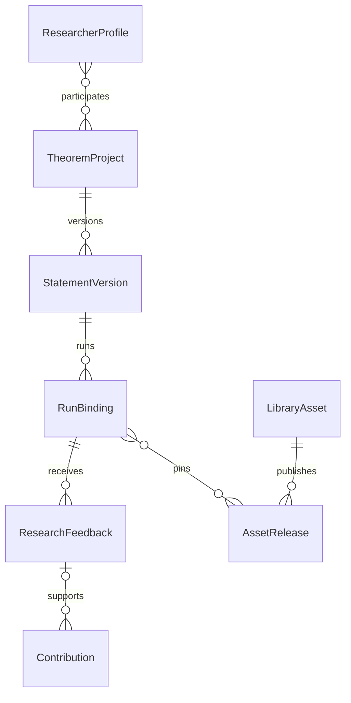

# TheoremOS 数学协作与共享能力开发文档

版本：v0.1 设计稿

日期：2026-11-09

范围：数学家、定理、Library 三个界面；人工干预与反馈；个性化 Agent、Skill 及选择性分享。

状态：已实现、合入主分支并于 2026-11-09 发布；13:05 修复删除研究笔记导致 Worker 退出的问题，13:29 进一步上线节点反馈标记、按运行和精确任务版本筛选、固定版本跳转及草稿保留，当前线上源码为 `891de7a5bc8a86bc583ce370efbbf84a637b8026`。实现、验证与发布结果见[实现交付记录](collaborative-research-implementation.md)和[发布状态](web-release-status.md)。本文保留原始设计及开发前基线，接口与文件的最终名称以交付记录和源码为准。

## 目录

- [1. 开发目标与交付范围](#1-开发目标与交付范围)
- [2. 现有能力与新增工作](#2-现有能力与新增工作)
- [3. 三个界面的设计](#3-三个界面的设计)
- [4. 协作角色与可见范围](#4-协作角色与可见范围)
- [5. 人工干预与反馈流程](#5-人工干预与反馈流程)
- [6. Agent 与 Skill 的创建和分享](#6-agent-与-skill-的创建和分享)
- [7. 核心数据与版本关系](#7-核心数据与版本关系)
- [8. 接口设计](#8-接口设计)
- [9. 实现位置与存储方案](#9-实现位置与存储方案)
- [10. 开发阶段与任务拆分](#10-开发阶段与任务拆分)
- [11. 测试与验收](#11-测试与验收)
- [12. 端到端验收案例](#12-端到端验收案例)

## 1. 开发目标与交付范围

让数学家能够围绕同一个定理持续协作：发现同行研究，查看证明路线，在受阻节点提供指导，看到系统如何处理指导，并将可复用的数学成果和研究方法分享出去。

本轮完整交付包含：

1. 数学家界面：个人研究、贡献、公开成果、同行动态，以及个人 Agent 和 Skill 管理入口。
2. 定理界面：题目版本、多次研究运行、路线与依赖、参与者、讨论、人工干预和验证证据。
3. Library 界面：共享数学成果的检索、发布、版本固定与复用；公开 Agent、Skill 的浏览与复制。
4. 反馈机制：提交、投递、采纳、执行和结果分别可追踪。
5. 个性化扩展：保存 Agent 配置与流程型 Skill，试用、发布和派生版本。

按三个阶段实施，完整范围以第 10 节为准。首轮采用异步协作；多人可以分别提交建议和版本化修改，界面保留各自草稿。首轮不包含同时编辑同一文档的协同编辑器、模型参数训练、任意可执行插件上传和新的社交消息系统。

关键完成条件：一项人工建议能够追溯到后续计划或任务变化；一项共享引理能够在另一位用户的运行中被重新检查和引用；使用的 Agent、Skill、题目及库版本均可查明。

## 2. 现有能力与新增工作

| 能力 | 已有基础 | 本轮新增 |
| --- | --- | --- |
| 账号与数据归属 | 邮箱账号、会话、按 owner 隔离的运行和持久化 | 数学家公开资料、定理成员关系和按资源授权的协作访问 |
| 研究过程 | 运行观测、任务图、路线、依赖、阻碍、前沿和源码检查记录 | 以定理汇集多次运行，完善面向数学家的概览、节点操作和跨用户参与 |
| 人工干预 | 定向指导、计划预览与编辑、精确版本的计划批准 | 记录提交人、采纳决定、后续变化和贡献归属 |
| 数学库 | 本账户知识目录、版本化 library catalog、固定源码与环境、实际引用记录 | 跨账户发布、发现、导入和来源展示 |
| 个性化策略 | M1/M3/M4/M5 文字规则、调度与上下文预设、持久方案库 | Agent 与 Skill 编辑器、不可变发布版本、开源分享和派生关系 |
| 证明验收 | M2 精确声明检查、S3 完整原题独立验收 | 复用现有标准，补齐协作页面的证据关联 |

实现依据：

- [网页工作台与协作接口](web-workbench.md)
- [现有协作数据结构](../apps/web/collaboration.ts)
- [已有任务图与研究界面](../apps/web/client/collaborationView.tsx)
- [指导投递](../src/solver/humanGuidance.ts)与[版本化计划编辑](../src/solver/humanEdit.ts)
- [本账户知识目录](../apps/web/knowledgeService.ts)与[版本化库目录](library-catalog.md)
- [策略方案注册与保存](../apps/web/moduleRegistry.ts)、[策略规则约束](../src/solver/modules/policy.ts)
- [固定的最终验收](../src/solver/evaluation.ts)

现有任务图、知识目录和模块方案应直接扩展。跨账户共享、数学家贡献主页和 Skill 发布机制属于新增能力。

## 3. 三个界面的设计

主导航为「数学家」「定理」「Library」，保留当前工作台作为创建和执行研究的入口。页面采用现有 Web 服务与前端技术，不增加新的前端框架。

建议首版页面地址：`people.html?id=P`、`theorems.html?id=T`、`library.html?entry=L&version=V`。无 ID 时显示目录或当前用户视图。具体定理节点使用 `run=R&task=N` 定位，节点版本作为详情参数保留。

### 3.1 数学家界面

| 区域 | 展示内容 | 操作 |
| --- | --- | --- |
| 资料 | 显示名、研究领域、简介、公开链接 | 本人编辑；访问者查看公开资料 |
| 我的研究 | 我发起、参与、关注的定理；当前卡点和等待反馈 | 继续研究、进入节点、处理待办 |
| 贡献 | 提出问题、修订形式化、提供路线、证明修复、审阅、共享成果 | 打开对应产物、版本、证据和来源 |
| 同行动态 | 关注的人、定理或领域中的公开变化 | 关注、筛选、进入研究并提出建议 |
| 我的工具 | 私有或公开的 Agent、Skill 与版本 | 创建、试用、编辑、选择发布 |

贡献由实际操作和已关联结果生成。记录「某人提出路线」「某 Agent 完成证明构造」「Lean 检查通过」各自的事实，保留不同参与者的作用。用户可以补充贡献说明，客户端不能自行提交“已证明”状态。

动态按时间倒序展示，首版支持关注数学家和定理、按领域筛选。私有研究不进入公开动态；公开动态的目标撤回或失去访问权后，列表同步隐藏该项。

空状态分别引导创建研究、浏览公开定理、补充资料；没有贡献记录时不生成推测性成果或统计。

### 3.2 定理界面

顶部展示自然语言或 TeX 原题、领域、发起者、参与者、当前陈述版本。题意确认、Lean 编译、完整证明验收分别展示；外部官方评测另列来源和结果。

主体由四部分组成：

1. **研究概览**：已完成的工作、当前缺口、等待人判断的事项，以及各次运行的状态。
2. **路线图与列表**：按所选运行展示候选路线、引理依赖、负责人和受阻原因；支持筛选路线、展开节点、切换列表。
3. **节点详情**：完整命题与假设、该节点的用途、依赖、当前负责人、尝试记录、源码、检查证据和干预入口。
4. **研究时间线**：人工建议、计划变更、Agent 交付、验证结果和发布记录；每项可跳转到具体版本。

一个定理关联多个陈述版本，每个版本可以关联多次运行。界面必须显式选择版本与运行；不同运行的任务图分别展示，可并列比较，不自动合并成一张已完成的证明图。证明状态属于具体陈述版本。

运行保留既有 Web run ID；solver run ID、任务 ID、任务版本、观测序号继续使用原有身份。浏览器中的“认领引理”属于人类协作记录，不能覆盖 solver 中表示 Agent 工作槽的 `ownerId`。

路线图需要区分：计划依赖、已检查的条件性推导、无条件获证的引理、完整原题验收。保留失败路线及停止原因。没有新观测时显示最后更新时间，继续保留节点选择、反馈草稿和阅读位置。

移动端默认使用路线列表与节点详情，所有干预操作也能通过列表和键盘完成。新页面同步提供中英文文案。

### 3.3 Library 界面

分为「数学成果」与「研究工具」两类，默认进入数学成果。

| 内容 | 列表与详情必须展示 | 操作 |
| --- | --- | --- |
| 数学成果 | 数学陈述、完整前提、Lean 限定名、环境、来源、维护者、版本、检查证据 | 搜索、查看依赖、下载、用于新研究、查看实际引用 |
| Agent | 用途、配置说明、模型要求、依赖 Skill、作者、版本、示例 | 查看配置、复制到个人空间、固定版本使用 |
| Skill | 适用情境、输入与产物、步骤、适用角色、依赖、作者、版本 | 查看正文、复制修改、加入研究配置 |

数学成果支持自然语言关键词和 Lean 名称检索，按领域、环境和作者筛选。详情明确标注证明范围：原定理、辅助引理或带条件结果。

数学成果发布流程：选择条目与依赖 → 预览将公开的内容 → 填写来源和许可证 → 打包并检查 → 生成不可变版本。打包或编译失败时保留草稿和诊断，条目不进入可复用的公开版本列表。

知识目录提供检索接口与历史上下文；library pack 提供可安装源码模块。发布流程需核对二者的来源与依赖关系，不能把普通历史检索条目直接视为可安装模块。首版发布范围限于能够完整打包并在所声明环境中检查通过的成果。

“用于研究”将选定版本和完整依赖闭包复制为该次运行的固定输入。环境不匹配时显示差异，并阻止直接安装；适配工作形成新版本或新研究。检索命中、选择、安装、尝试使用、检查后的实际引用分别记录。

## 4. 协作角色与可见范围

定理可见范围为 `private`、`members`、`public`，新建默认私有。数学家资料、定理、运行投影和 Library 发布分别设置公开范围。

| 操作 | 发起者 | 受邀协作者 | 只读成员 | 公开访问者 |
| --- | --- | --- | --- | --- |
| 查看定理资料与允许共享的内容 | 是 | 是 | 是 | 仅公开部分 |
| 讨论与提出建议 | 是 | 是 | 是 | 登录后可向公开定理提建议 |
| 修改题目、建立陈述版本 | 是 | 是 | 否 | 否 |
| 管理成员和定理可见范围 | 是 | 否 | 否 | 否 |
| 向运行投递指导、编辑或批准计划 | 取决于运行授权 | 取决于运行授权 | 否 | 否 |
| 发布成果或工具 | 发布本人拥有的内容 | 发布本人拥有的内容 | 发布本人拥有的内容 | 登录后发布本人拥有的内容 |

运行绑定到定理时，由运行所有者明确选择：只读、允许协作者指导、允许协作者改计划、允许协作者批准计划。后者逐项授权，默认只读。定理发起者身份不自动授予他人运行的控制权。

发起运行、连接模型、调整执行预算、取消整个运行仍由运行所有者操作，计费账户不因协作而改变。协作者可以在自己的账户下发起另一次运行并绑定到同一定理。

当前 `/api/runs/*` 和 `/api/knowledge/*` 保持原有 owner 归属。新增定理接口经过成员与运行授权检查后，由服务器解析真实运行所有者，读取白名单字段或转发允许的命令；客户端不能指定 owner 路径。公开访问复用受限分享投影，不能读取完整私有运行、内部日志和模型连接。

新增写接口继续使用现有登录、同源及 CSRF 检查。成员撤权和可见范围修改在后续请求中生效，公开索引与缓存不作为授权依据。管理员继续没有默认跨账号读取研究的权限。

## 5. 人工干预与反馈流程

### 5.1 四类操作

| 类型 | 输入与处理 | 生效时机 |
| --- | --- | --- |
| 数学指导 | 针对 Lead、Agent 或精确版本的节点提供思路、文献和判断 | 当前运行接收后，在后续调度或会话消费点进入上下文 |
| 计划修改 | 预览并提交完整的版本化计划；展示节点、依赖和路线差异 | 宿主接纳对应 `baseVersion` 后生效，界面显示待同步或已应用 |
| 人工成果 | 上传候选 Lean 修改或辅助引理，与任务版本、源码和环境绑定 | 在独立候选工作区检查，按现有交付与集成流程处理 |
| 路线暂停 | 提交对应计划变更，暂停相关组或任务 | 生效后停止新派发；已有工作显示继续收尾或停止状态 |

公开讨论建议先保存在定理讨论中，不要求定理已有运行，也不要求建议者能访问私有运行。获得运行授权的参与者可将建议投递到选定运行：新建指导记录，以 `sourceFeedbackId` 关联原建议，记录实际投递人，原建议继续保留作者和原文。讨论、投递、采纳分别形成记录。暂停某条路线不会自动取消同次运行的其他路线。

人工成果不能直接覆盖正在写入的 solver 工作树。接入既有版本检查、候选源码检查、声明级集成和 S3 验收。结果过期或检查失败时保留原提交与原因。

### 5.2 状态分开记录

现有指导的 `queued / delivered / deferred / failed` 保持原义。`delivered` 表示通知已投递；增加独立的采纳和执行记录。

| 维度 | 建议状态 | 状态来源 |
| --- | --- | --- |
| 投递 | `not-sent / queued / delivered / deferred / failed` | 既有命令和指导回执；`not-sent` 表示仅存为建议 |
| 决定 | `pending / accepted / declined / needs-info / not-recorded` | 数学家显式决定，或宿主收到的绑定版本的结构化 Agent 交付 |
| 执行 | `not-started / running / completed / failed / superseded` | 关联的计划应用、任务活动和结果 |
| 数学证据 | 原有检查、集成、S3 与适用的官方结果 | 固定源码、声明、环境和回执 |

旧运行没有采纳字段时显示“未记录采纳结论”。Agent 表示赞同只能生成采纳决定；实际计划变化、任务交付和证明通过分别需要对应证据。研究工作完成也可以形成执行结果，但其数学证据仍可能为“尚未获证”。

页面用连续事件展示一次反馈的处理过程：


每条记录包含提交人、接收方、原观测、节点版本、时间、理由和关联产物。采纳决定可来自数学家或 Agent，界面显示决定来源。Agent 决定通过现有 worker 交付通道返回，由宿主校验身份和引用后保存。

### 5.3 版本冲突、重试与更新

- 指导继续绑定 `observationRef` 与精确 `taskRef`；任务已改版时返回冲突并保留草稿，不转投新版本。
- 计划编辑继续要求 `baseVersion`，批准继续要求精确 `planVersion`。并发修改只接受与当前版本一致的请求，其余返回差异供重新预览。
- 每次提交使用稳定 `requestId`；相同 ID、相同内容返回原结果，相同 ID、不同内容返回冲突。超时后先查询原回执。
- 反馈先持久化再投递，记录自身即为待投递项。服务恢复时按原指导 ID 或命令 ID 查回执，再恢复未完成操作，保留现有运行中断语义。
- 收件回执的首版测试目标为正常服务下 2 秒内返回；模型采纳不承诺固定耗时。页面显示等待原因、最后观测时间和实际送达时间。
- 运行所有者继续使用现有运行变更通知；协作者页面首版按需轮询授权观测与按序事件，不直接订阅所有者的全量账号流。页面恢复前台后补读，并保留选中节点和草稿。

采纳、退回、需要补充信息及关联任务完成进入站内待办。邮件或外部聊天通知不属于本轮交付。

## 6. Agent 与 Skill 的创建和分享

### 6.1 Agent 配置

Agent 编辑器提供名称、用途、领域、研究偏好、可选模型设置、协作角色、调度预设、上下文预设、Skill 版本和库版本。模型选择限于平台现有服务商能力；模型密钥由每个使用者自己的连接提供。

Agent 草稿可更新；发布版本不可变。修改已发布配置生成新版本。已开始的运行保留原配置，不因作者更新默认值或撤回公开版本而静默换用配置。

现有模块方案继续只保存其原有字段；Agent 配置在其上组合模型偏好、Skill 和库引用。旧方案可显式导入为个人 Agent 草稿，不自动转换已有运行。

### 6.2 Skill v1

Skill 保存可复用的文字指令和研究检查清单：

| 字段 | 说明 |
| --- | --- |
| `name / description` | 名称、用途和适用情境 |
| `inputs / outputs` | 所需材料与预期产物 |
| `steps / instructions` | 建议步骤与具体指令，支持 Markdown |
| `slots / roles` | 适用的 M1/M3/M4/M5 建议位置和研究角色 |
| `dependencies / examples` | 固定版本的依赖、示例及实际试用结果 |
| `author / license / derivedFrom` | 作者、分享许可和派生来源 |

例如，“归纳证明检查清单”描述选择归纳参数、审视是否需加强命题、拆解基础情形和归纳步骤、检查剩余目标。首版步骤是研究建议，执行记录关联实际运行；不据 Agent 自述生成确定性的“所有步骤完成”或证明验收。

编辑器提供模板、预览、保存草稿和创建试运行。试运行使用本人模型连接和显式选择的预算；保存或发布配置本身不调用模型。声明支持的工具沿用平台现有工具，不接收新的可执行脚本。

### 6.3 编译为现有研究配置

启动运行时解析 Agent 与 Skill 的固定版本，按用户选择的顺序组合成现有 `ResearchModulePlan` 和角色建议。首版只作用于证明研究上下文，保留形式化盲回译的独立输入与 M2、S3 标准。

合并配置继续使用现有规则上限：最多 8 个自定义规则、单项 4,000 UTF-8 字节、合计 16,000 字节；规则冲突或超过限制时在提交前明确指出，不静默截断。同一位置的多个 `replace` 规则按现有校验拒绝，用户需显式调整。

冻结配置保存各版本、内容摘要和最终生效配置，列出启用及未启用的规则。后续恢复只读取该次运行的固定副本。

### 6.4 选择性开源分享

发布流程为：保存草稿 → 查看最终公开内容 → 填写许可证和依赖 → 发布固定版本。公开数学成果、Agent、Skill 和研究过程分别选择，不相互连带公开。

他人可以引用固定版本，也可以复制为私有草稿后修改；派生版本保留原作者、来源版本和许可。数学成果显示 Lean 证据，工具显示配置校验和具体试用记录，采用各自的结果标记。

## 7. 核心数据与版本关系

以下实体为建议的新 Web 层数据。现有 `WebRun`、solver checkpoint、检查回执和知识目录继续使用原结构，通过 ID 与固定摘要引用。

| 实体 | 核心字段与约束 |
| --- | --- |
| `ResearcherProfile` | 公开 `id`、服务端 `accountId`、显示名、领域、简介、公开范围；登录邮箱不进入公开投影 |
| `TheoremProject` | `id / ownerAccountId / title / visibility / members / currentStatementVersionId / revision` |
| `StatementVersion` | 原题、Lean 陈述、假设、目标、来源、形式化引用、源码及环境摘要、题意确认人和时间；固定后不可覆盖 |
| `RunBinding` | `projectId / statementVersionId / webRunId / runOwnerAccountId / interactionGrants / exposure`；真实 owner 仅服务端解析 |
| `HumanAssignment` | 人类认领者、精确任务引用、状态和提交物；独立于 solver worker 分配 |
| `ResearchFeedback` | 提交人、类型化内容、原建议引用；讨论绑定定理或陈述，运行操作另绑定接收方、版本、观测和对应产物；保留回执、决定、执行与结果 |
| `Contribution` | 人类或 Agent 来源、贡献类型、对应实体与版本、操作记录、采纳或检查证据 |
| `LibraryAsset` | 稳定条目 ID、类型 `mathematics / agent / skill`、作者、可见范围和可变草稿 |
| `AssetRelease` | `assetId / version / digest / manifest / dependencies / license / provenance`；发布后不可变 |
| `Publication` | 发布请求 ID、草稿版本、阶段、诊断和成功后的 release 引用 |
| `RunConfigurationSnapshot` | 题目、Agent、Skill、数学库的版本与摘要，以及最终生效配置 |
| `Follow / Notification` | 关注的人或定理；有权限访问的事件、已读位置和处理入口 |



反馈采用按 `kind` 区分的应用层结构；完整校验使用 Zod，并复用现有任务、计划和观测类型。下例中的 `WebGuidanceInput`、`WebPlanProposal` 引用既有协作类型，身份与提交人由服务端填写：

```ts
type TaskRef = { id: string; version: string };
type RunTarget = {
  webRunId: string;
  statementVersionId: string;
  task?: TaskRef;
  observation: { sequence: number; stateDigest: string };
};
type FeedbackSubmission =
  | { kind: 'discussion'; target: { statementVersionId?: string };
      payload: { text: string } }
  | { kind: 'guidance'; target: RunTarget;
      payload: { text: string; recipient: WebGuidanceInput['recipient'] } }
  | { kind: 'plan-edit'; target: RunTarget & { planVersion: string };
      payload: { text: string; proposal: WebPlanProposal } }
  | { kind: 'proof-submission'; target: RunTarget & { task: TaskRef };
      payload: { text: string; baseCommit: string; baseSourceDigest: string;
        files: { file: string; source: string }[] } }
  | { kind: 'route-control'; target: RunTarget & { planVersion: string };
      payload: { text: string; routeId: string; action: 'pause' | 'resume';
        proposal: WebPlanProposal } };

type ResearchFeedback = FeedbackSubmission & {
  id: string;
  requestId: string;
  projectId: string;
  authorResearcherId: string;
  sourceFeedbackId?: string;
  delivery: {
    status: 'not-sent' | 'queued' | 'delivered' | 'deferred' | 'failed';
    guidanceId?: string;
    commandId?: string;
    reason?: string;
  };
  decision: {
    status: 'pending' | 'accepted' | 'declined' | 'needs-info' | 'not-recorded';
    actor?: { kind: 'human' | 'agent'; id: string };
    reason?: string;
    evidenceRefs: string[];
  };
  execution: {
    status: 'not-started' | 'running' | 'completed' | 'failed' | 'superseded';
    planVersion?: string;
    taskRefs: { id: string; version: string }[];
    resultRefs: string[];
  };
  revision: number;
  createdAt: string;
  updatedAt: string;
};
```

贡献的“记录、采纳、获证”由各自证据派生。数学成果的使用沿用 `reported-attempt` 和 `checked-reference`：只有固定检查证实当前消费者实际引用对应声明时，才显示已验证使用。实现依据为[知识使用契约](../src/solver/knowledgeUsageContract.ts)。

## 8. 接口设计

### 8.1 复用的接口

以下接口已存在，保留现有归属与版本语义：

| 接口 | 用途 |
| --- | --- |
| `GET /api/runs/:id/observation` | 当前观测、计划、路线、前沿、任务及证据 |
| `GET /api/runs/:id/events?after=N` | 按序号读取保存事件及保留范围 |
| `POST /api/runs/:id/guidance` | 提交版本绑定的指导 |
| `GET /api/runs/:id/guidance/:guidanceId` | 查询指导投递 |
| `POST /api/runs/:id/edits/preview`、`POST /api/runs/:id/edits` | 预览和提交计划修改 |
| `POST /api/runs/:id/plan-approval` | 批准精确版本的计划 |
| `GET /api/runs/:id/commands/:commandId` | 查询原命令结果 |
| `GET /api/knowledge/catalogs`、`GET /api/knowledge/search`、`GET /api/knowledge/:entryId` | 本账户知识版本、检索和详情 |
| `GET /api/modules`、`GET/POST /api/module-plans` | 可用实现和个人模块方案 |

人工成果提交、跨账户访问和指导采纳关联尚需新增，不能只修改现有按钮文案。

### 8.2 建议新增的接口

统一使用 `/api/research` 命名空间。以下路径均为开发提案。

| 接口 | 输入或返回重点 |
| --- | --- |
| `GET /api/research/people`、`GET /api/research/people/:id` | 领域、关键词、分页；公开资料、可见贡献和成果 |
| `PUT /api/research/profile` | 本人资料与公开设置，带预期版本 |
| `GET/POST /api/research/theorems` | 有权访问的定理列表或创建定理 |
| `GET/PATCH /api/research/theorems/:id` | 概览、成员、版本和运行列表；修改项目资料 |
| `PUT /api/research/theorems/:id/members/:researcherId` | 添加、调整或撤销成员角色 |
| `POST /api/research/theorems/:id/versions` | 建立新陈述版本，保留原版本 |
| `POST /api/research/theorems/:id/runs` | 将本人运行绑定到版本并明确共享范围和操作许可 |
| `GET /api/research/theorems/:id/runs/:runId/observation` | 授权后的运行投影；不返回账号级其他资源 |
| `GET/POST /api/research/theorems/:id/feedback` | 读取或提交建议、指导、计划修改、人工成果或路线控制 |
| `GET /api/research/theorems/:id/feedback/:feedbackId` | 完整处理状态与关联结果 |
| `POST /api/research/theorems/:id/feedback/:feedbackId/decision` | 有权处理者记录显式决定、理由和版本引用 |
| `GET /api/research/theorems/:id/activity?after=N` | 定理事件与贡献时间线 |
| `GET/POST /api/research/library` | 搜索可见资产，或创建数学成果、Agent、Skill 草稿 |
| `GET/PATCH /api/research/library/:assetId` | 读取资产或修改本人草稿 |
| `POST /api/research/library/:assetId/publish` | 固定草稿并启动发布；返回发布请求 ID |
| `GET /api/research/publications/:id` | 发布的排队、校验、失败或完成状态 |
| `GET /api/research/library/:assetId/releases/:version` | 固定版本、摘要、依赖和可下载内容 |
| `POST /api/research/library/:assetId/fork` | 复制指定版本为本人草稿，保留派生关系 |
| `POST/DELETE /api/research/follows/:kind/:id` | 关注或取消关注数学家、定理 |
| `GET /api/research/feed`、`GET /api/research/notifications` | 可见动态与站内待办，支持分页 |

同一路径的反馈提交按 `kind` 分别校验 payload。`discussion` 仅要求有权向定理提交建议，目标运行及观测均非必需；其他类型按具体运行授权校验。正文、接收方和长度继续遵守既有 Web 指导限制，计划使用既有计划 schema，候选源码使用现有上传与源码大小限制。附件不接受任意容器路径或 shell 命令。

所有新增写请求带 `requestId`，对可变资源的更新再带 `expectedRevision`。响应包含资源 ID、最新 revision 与状态；长操作返回 `202` 和可查询 ID。未知执行结果先读状态，不建立新的请求 ID 重做。

新增接口的错误约定：不可见资源返回 `404`；可见但无操作权限返回 `403`；版本或幂等内容冲突返回 `409`，同时返回可读取的当前版本；输入校验失败返回 `400`。冲突不会清空浏览器草稿。

## 9. 实现位置与存储方案

### 9.1 模块职责

以下为建议新增或扩展的位置，不表示这些文件已存在：

| 位置 | 职责 |
| --- | --- |
| `apps/web/researchProjects.ts`（新增） | 数学家资料、定理版本、成员、运行绑定、反馈和贡献；向调用方提供读视图、提交操作、应用运行事件的入口 |
| `apps/web/researchAssets.ts`（新增） | 数学成果与工具草稿、发布校验、不可变版本、派生和固定输入 |
| `apps/web/researchContracts.ts`（新增） | 纯数据类型与 Zod schema；可由客户端引用，不加载 solver |
| `apps/web/server.ts`（扩展） | 身份解析、路由、现有 CSRF 检查和新模块调用 |
| `apps/web/workerBridge.ts`、现有交付协议（扩展） | 关联反馈 ID、处理结构化采纳记录和已有运行事件 |
| `apps/web/client/`（扩展） | 三个入口与编辑器；复用任务图、节点检查器、知识详情和模块配置 |
| `src/solver/humanGuidance.ts`、`humanEdit.ts`（按需扩展） | 延续精确版本的指导和修改；solver 使用中性的反馈引用，不依赖 Web 账号模型 |
| `src/solver/modules/`（按需扩展） | 将固定 Agent、Skill 配置接入现有建议规则与上下文清单 |

CLI 与数学运行时继续独立于 Web。Web 账号、成员授权和公开目录不进入 solver；运行时只消费已经固定的题目、规则、数学库与必要引用。M2、S3 继续承担原有检查职责。

### 9.2 持久化与恢复

复用 `WebStorage` 的 JSON 记录、原子保存和不可变对象能力。新增资料、定理、反馈和资产记录使用独立目录，避免移动现有 `owners/.../runs`。首版部署保持单 Web 写入实例，通过资源级串行操作、revision 比较和原子替换处理并发修改。

项目和反馈记录为业务事实来源；动态、计数和目录索引可从其重建。索引滞后不影响权限判断，也不授予证明状态。发布先写完整的不可变对象与 manifest，再更新可见版本索引；用稳定发布 ID 恢复中断步骤。

现有运行不自动变成公开定理。用户选择绑定历史运行时建立版本映射；绑定不完整或来源版本不匹配时提示补充，不能为旧结果推测采纳记录或新的验证结论。

撤回发布后停止公开发现和新的下载；已经进入其他运行的固定副本保留在该运行内，不静默替换。原运行删除后其共享入口失效，独立发布的资产按其自身设置管理，删除前说明影响范围。账号删除与资源清理需覆盖新增资料、授权、反馈公开投影和自有发布物，并同步现有隐私说明；他人已明确复制的成果不反向开放原账号数据。

## 10. 开发阶段与任务拆分

| 阶段 | 开发任务 | 可验收交付 |
| --- | --- | --- |
| A：定理研究与人工反馈 | 定理及版本、运行绑定、成员授权、复用路线图、提交人、采纳记录、时间线、数学家基础资料 | 两个账号围绕一个定理协作；能从指导追溯到计划变化和结果 |
| B：贡献与共享数学库 | 贡献投影、同行动态、关注与待办、数学成果打包检查、公开目录与跨账户复用 | 一条引理从研究发布到 Library，被另一账号的新运行重新检查并实际引用 |
| C：研究方法扩展 | Agent 编辑器、Skill 模板与编辑器、配置组合、版本快照、试用、许可证和开源派生 | 用户创建个人方法，试用后发布，另一用户固定版本使用或派生 |

每阶段同时交付数据结构、服务端接口、界面和对应测试。资源模型与权限先于跨账户界面；现有计划与证据语义先于采纳展示；数学资产发布先于复用统计；配置冻结先于工具分享。

可并行开发已明确契约的界面、存储及测试夹具；共享 schema、运行命令和反馈状态的修改按依赖顺序集成。人力与排期在阶段任务认领后估算，不在本文假设固定工期。

## 11. 测试与验收

服务端测试使用临时 `WebStorage` 和可丢弃账号夹具；运行回执与 Agent 交付使用模拟 worker。需要验证证明证据时使用固定 Lean 题目与适用的比较器，不将模型文字输出作为通过条件。

| 验收项 | 必须覆盖的行为 |
| --- | --- |
| 版本关系 | 一个定理保留多个陈述版本与多次运行；新版本不覆盖旧版本的证明状态 |
| 跨账户授权 | 私有资料不泄漏；只读成员不能投递命令；协作者不能控制未授权的运行；撤权后访问失效 |
| 提交与重试 | 同 ID 重试只有一份记录与一次有效投递；同 ID 不同内容冲突；超时查询原结果 |
| 并发修改 | 两人基于同版本改计划仅一项生效，另一人保留草稿并得到冲突信息 |
| 反馈采纳 | 能分别显示已投递、采纳理由、实际改动与结果；缺少采纳记录保持未知 |
| 讨论与转投 | 没有运行时可保存建议；无运行访问权的用户可向公开定理建议；授权转投另建记录并保留原作者与来源 |
| 过期任务 | 节点或陈述改版后，不将旧指导和候选证明应用到新版本 |
| 人工源码 | 候选在隔离工作区检查；失败和过期提交不覆盖正在执行的源码 |
| 证明状态 | 条件性路线、部分引理获证、研究交付、整题 S3 和官方结果分别显示 |
| 数学库 | 依赖、源码或环境不匹配时拒绝直接安装；发布重试不产生重复版本；实际引用有检查证据 |
| 配置组合 | Agent 与 Skill 冲突、超长规则、缺失版本在启动前报错；运行与恢复保留固定配置 |
| 分享范围 | 发布工具不公开运行和密钥；撤回资产后停止新的公开下载，已有固定运行可复核 |
| 页面体验 | 观测更新保留节点、草稿和阅读位置；断线显示过期状态；移动端和键盘可完成操作 |
| 持久化 | 重启后项目、反馈、发布和幂等身份仍在；按原回执恢复，不自动重启已中断的模型运行 |

扩展现有相关测试：`tests/humanGuidance.test.ts`、`tests/webCollaboration.test.ts`、`tests/solverPlanApproval.test.ts`、`tests/webKnowledgeApi.test.ts`、`tests/webModulePlan.test.ts`、`tests/knowledgeUsageObservation.test.ts`。新增项目、资产和分享测试通过各模块公开入口验证行为。

实现后的基本检查为 `bun run typecheck`、`bun run typecheck:web` 及受影响的定向测试。修改运行时边界时按仓库要求执行 `bun run build`；修改前端资源时执行 `bun run build:web` 并检查三个页面的桌面与移动端流程。上述是后续实现要求，本文交付不宣称这些新增功能已经通过测试。

## 12. 端到端验收案例

准备 A、B、C 三个可丢弃账号和一题固定的求和不等式，题目具有两条候选路线与至少一个可独立检查的辅助引理。自动验收使用模拟 Agent 交付和真实 Lean 检查；实际用户试用再选择真实研究题目。

1. A 建立定理和陈述版本，在本人账户下启动研究，选择允许 B 查看和干预的运行范围。
2. B 从同行动态进入定理，在路线图中选中受阻引理，提交数学指导。
3. 页面先显示收件与投递状态，再显示采纳来源和理由；后续计划新增一个辅助任务，指导可跳转到该变更。
4. 辅助任务交付并通过对应检查；定理页保留引理状态与整题状态的区别，B 的贡献关联该节点和指导。
5. A 将可完整打包的引理及必要依赖发布为数学库版本，预览不包含私有讨论或模型连接。
6. C 从 Library 查看成立条件与环境，在本人新运行中固定该版本；重新检查和实际引用形成使用记录。
7. A 将研究方法保存为 Skill，并建立引用它的 Agent，试用后选择开源发布；C 可查看、固定版本使用或派生。
8. A 发布新版本后，C 已开始的运行仍使用原版本；任意步骤刷新、断线重试或服务恢复均不重复发布、投递或启动模型任务。

交付评审从三个人的界面检查上述流程，并核对底层版本、命令回执和 Lean 证据。完成阶段 C 后，三个组会方向才具备本文约定的完整开发交付。
