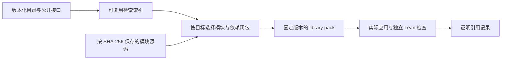

# 版本化 Lean 库目录

库目录面向 Lean 定理、定义与证明模块。`owner/name` 标识库，`revision` 标识一个发布版本，目录文件的 SHA-256 固定该版本的准确内容。相同模块文件名在不同发布版本中可以有不同内容；一次安装只读取选定目录及其固定源码，不自动跟随 `latest`。



`catalog.json` 只保存接口、模块名、源码摘要、依赖与来源；证明正文位于 `objects/<sha256>.lean`。读取目录和检索不会打开这些源码对象。选中模块后才核对源码摘要，生成现有 `library-pack`。自动装库先按模块保留最佳声明，再截取候选模块，避免一个含大量相似定理的模块占满检索结果。多个原始目标轮流获得模块名额，已经装入的依赖不再重复占用名额，同一超预算模块也只检查、记录一次。库目录可超过单个任务的安装上限；每个任务仍最多安装 256 个模块、16 MiB 源码，自动选库会跳过超过这个预算的依赖闭包。显式导入若超出预算会明确失败。

任务文字明确写出公开声明的完整限定名时，例如 `TheoremOS.BooleanCube.sign_sq`，对应模块先于相似度候选获得自动安装名额，仍受默认四个根模块、依赖闭包、冲突与安装预算限制。支持 `_root_.` 前缀，按首次提及顺序选择；短名和部分名称不触发此优先级。`source` 中显式 `import Submission.Library.…` 的完整依赖仍按必需模块处理，不占自动名额。选库保留原题源码字节，实际证明应用时才添加所需导入。

模块安装后，点名声明继续优先进入实际调用候选。已安装库的展示与 host 应用共用点名和目标检索逻辑：先读取当前分工目标中的完整限定名，再读取运行指令和冻结题目说明，合并目标检索结果；只有已安装且源码摘要匹配的公开声明可被提升。展示可以包含定理和定义，最多三条；自动应用在排序和截取十二条候选之前先筛选定理，定义不会占用调用名额。每种用途内，点名候选与相似度候选共用名额。原始题目、批准形式化后的附加指令及协作任务都走这条消费链。短名继续走普通检索，历史知识目录的排序不受此优先级影响。

先把已有 pack 建成目录：

```bash
bun bin/math.ts library-catalog build \
  --pack core-pack.json --pack algebra-pack.json \
  --id example/lean-library --revision v1 \
  --environment mathlib --output ./library-v1
```

每个输入 pack 必须包含自己的完整本地依赖。多个 pack 中相同模块的字节和来源必须完全相同，目录会合并这些重复模块。同一目录内不同模块的公开声明不能重名，以便选中模块可以共同导入；私有声明不受此限制。输出目录必须不存在。构建结果打印 `digest`，消费时可以用它固定版本：

```bash
bun bin/math.ts library-catalog search \
  --catalog ./library-v1/catalog.json --sha256 DIGEST \
  --query 'TheoremOS.BooleanCube.sign_sq'

bun bin/math.ts library-catalog select \
  --catalog ./library-v1/catalog.json --sha256 DIGEST \
  --source problem.lean --task task.md --output selected-pack.json
```

`select` 同时输出 `selected-pack.json.lock.json`，记录库名、版本、目录摘要和逐模块摘要。生成的 pack 可直接交给已有 bootstrap 的 `--library-pack`。搜索结果提供准确的限定名、模块 `import` 和源码摘要；类型预览不足时，应查看对应模块中的完整声明和 section 假设。索引只表示接口存在，适用性由本次 Lean 检查决定。

搜索结果的 `namedReferences` 单独返回精确点名的公开声明及所在模块，包括只有 `structure`、`class` 或 `inductive` 的模块；只查元数据即可定位并选择它们。此字段不提供类型预览或把这些类型声明当作可应用定理，定理与定义的相似度结果仍放在 `hits`。

Web 默认使用 `resources/theorem-os-library/release/catalog.json`。私有 worker 镜像可通过 `THEOREMOS_LIBRARY_CATALOG` 与 `THEOREMOS_LIBRARY_CATALOG_SHA256` 一起指定另一个 Mathlib 目录；构建预检库和运行 worker 时必须使用同一组值，并将该目录及 objects 装入镜像。只指定路径而不指定摘要会被拒绝。默认单 worker 与协作任务共用按需装库和实际应用流程。

默认私有目录同时保留上游模块与本地原创模块的实际来源。上游模块使用 `origin.kind: upstream`；本次原创模块通过 host-authored 库规范 run 编译验收，再以 `keepOriginals` 提取，使用 `origin.kind: run` 记录真实 run ID、源码 commit 和回执摘要。`resources/theorem-os-library/authoring.json` 保存源码及编译输出摘要与公理依赖检查结果，源码副本位于相邻的 `authored/`。这些记录描述实际规范运行和 Lean 验收，不表示调用了求解模型。

大库的冻结快照复用一次构建的分词、词频、目标形状、引用关系和倒排索引。自动应用额外缓存仅含定理的元数据索引，不读取源码对象；面向模型的检索仍保留定义。普通可变目录的旧检索接口仍逐次读取新元数据。运行中的索引保存在进程内，不进入可序列化的冻结快照或改变其摘要。宽泛的目标仍可能评分大量候选，目标后缀匹配仍需扫描类型字符串。

按正式目标检索时，主要匹配去掉量词参数和箭头前提后的结论，声明名只提供较小的排序提示；完整类型及前提仍参与排序。这样不会仅因大量矩阵或分布前提相似，就把真正给出目标结论的定理挤到后面。结论检索没有匹配时回退到完整类型，保留依靠定义化简适用的通用定理。显式名称和关键词查询沿用原有优先级；无法拆分的类型继续按完整文本检索。

自动应用还会检查十二条主候选的前提，用当前目标的量词参数和假设作为上下文，在同一冻结定理索引中最多补搜八个不同前提。各主候选轮流提供前提，重复查询只占一个名额；辅助结果按查询顺序和结果名次交错选取，例如先考虑第一查询的首项、第二查询的首项，再考虑第一查询的第二项，兼顾不同前提与靠前查询的替代候选。最多三条辅助候选进入十二条调用池，并与发起查询的主定理一起保留；前三条主候选和所有已获名额的精确点名候选仍优先。有余位时还保留排名最高的一条前提已逐字出现在当前目标假设中、或没有显式证明前提的主候选，避免辅助项挤掉直接应用的机会；这一判断只比较解析后的前提形状。剩余名额不足以容纳主辅一对时跳过该辅助项。补搜只使用元数据，不自动装入其他模块、不递归扩展，也不表示前提已被实例化或证明；实际适用性仍由 Lean 判断。面向模型的普通展示不执行这一步补搜。

自动应用从仅含定理的检索结果中取最多 12 条。补充前提所需的辅助定理时，先保留结论与目标一致的主候选，以及前提已出现在局部上下文中的备选，避免辅助结果挤掉直接应用；结论比较会重新编号其中出现的绑定变量，兼容库的 section 参数没有写在声明头中的情况。这只是检索提示，仍须核对源码并通过本次 Lean 检查。

应用尝试 `exact` / `apply`，也可用 `Iff.mp` / `Iff.mpr` 消费双向命题的一侧，通过 `Eq.symm` 应用方向相反的等式，或用一次正向 `rw` 将库结论改写到目标的子表达式中。另有一个显式展开全部参数的 `refine'` 分支，使只出现在前提中的关系或谓词可以由局部假设确定；隐式参数、类实例和其余前提都必须关闭。这些主定理应用方式都可逐项尝试同一候选池中的其他定理来关闭前提或转换后的目标；辅助定理只应用一层，其剩余前提须由局部假设或 `rfl` 关闭，不递归展开。带前提的双向定理先形成显式证明目标，关闭其前提后再处理被转换的一侧，避免内部证明失败阻断后续尝试。重写后的目标和定理前提都必须关闭，每个分支必须关闭全部目标才算成功，总检查预算仍为 30 秒；界面和模型上下文保持最多三条简要推荐。最终证明引用才进入实际使用记录。

Web 的 Mathlib 解题 agent 还可主动检索整个固定版本，包括本题尚未安装的模块。宿主每回合写入 `LIBRARY.json`，绑定目录摘要、当前题目回执、seed commit 与已冻结模块；agent 使用独立工具：

```bash
theorem-os library search --worktree WORKTREE --query '数学关键词' --goal 'Lean 目标及局部假设'
theorem-os library get --worktree WORKTREE --name '完整限定名' --max-bytes 16000
theorem-os library request --worktree WORKTREE --name '完整限定名' --reason '具体用途及待关闭前提'
```

搜索结果以 `installed-frozen` / `not-installed` 标明当前安装状态。`get` 按需读取对应源码对象，返回完整模块的有界分页；用 `source.nextOffset` 继续读取，直到 `source.complete`，以保留 section 参数、实例和假设。每页完整 JSON 的 UTF-8 大小受 `--max-bytes` 限制。只允许定位公开声明，类型或结构也可按完整限定名定位；搜索不需要打开源码对象。

Web 的 Agent 活动把 `search`、`get`、`request` 的工具输出显示为库版本、候选声明、安装状态、源码分页和请求状态，复用现有活动存储。源码正文与宿主路径不进入卡片摘要；排队请求不显示为已安装或已引用。源码页的 `complete` 只说明该页已到模块末尾，不表示此前所有页都已读取。

最终报告的 `libraryUsage` 分别列出装入模块数、实际补装轮次，以及独立 S3 验收证明引用的公开声明。引用须绑定全部原始目标、准确提交和声明摘要，并与当前冻结模块及固定目录匹配；历史草稿、其他轮次与模型自报用途不计入。缺失引用信息显示未知，部分覆盖保留已知引用但不给出完整总数。摘要最多保留 64 个不同声明并标出省略数；这项记录不改变验收结果，也不推断检索导致了解题成功。

`request` 最多接受八个声明，写入 `LIBRARY_REQUEST.json` 后，agent 保存源码与 `RESEARCH.md` 并返回。排队本身不会安装模块。宿主验证目录、原题回执、seed 祖先关系、旧库字节、声明冲突及整个安装预算，保留现有模块并补齐请求的传递依赖。有效请求在全部 writer 关闭后令当前运行输出 `library_requested`；同时已有通过的候选仍优先交给验收。无效请求被记录和移除，继续原运行。

库文件属于冻结题目，运行中不会直接改写它们。Web supervisor 用同一份逐字原题、任务文字和已批准形式化证据建立新 bootstrap 与新回执，旧运行和旧回执留存。各 worker 的已保存可变源码、笔记及原续跑附件作为 advisory 材料传入新运行，不继承证明接受状态、不把旧草稿当新原题。附件较多时按种类合并，保留正文摘要及来源；仍受既有附件大小限制。新模块经过启动 Lean 检查，实际应用及完整原题继续走 M2 和独立 S3。

各子运行的 turns、求解时间与 provider 已报告 token 累计消费同一个 Web 请求预算。有限预算耗尽、或有限 token 预算缺少完整用量回执时，不再启动下一轮，不能把剩余的零误传为无限预算。`library-research.json` 保存每轮回执、安装模块、请求及续跑关系；最终 Web report 的用量是所有子运行合计。观察序号跨轮递增，solver 身份切换由宿主显式声明，旧轮的指导引用不能写入新轮。

worker 镜像把完整目录和源码对象发布在 `/opt/theoremos-library/release`，供无法读取应用树的 bundled `library` 工具使用。可用 `THEOREMOS_AGENT_LIBRARY_CATALOG` 指定另一可读副本，摘要必须与宿主选库目录相同。普通 CLI 可通过 `run --library-catalog FILE --library-catalog-sha256 DIGEST` 启用同样的工具；收到 `library_requested` 后由调用方负责建立新冻结续跑，自动监督目前在 Web 实现。

后续远端库平台可分发这套目录和按摘要寻址的源码对象。当前交付包含本地目录构建、检索、版本固定、按需读取、agent 安装请求及 Web 冻结续跑；上传、账号、托管和公开分享尚未实现。
