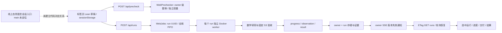

# main 工作台代码与本地验证审查

> 历史审查记录：下文归档 2026-11-03 的审查结果、证据和修改/测试建议。“未提交/推送”等描述指原审查阶段。PR #2 后续已加入产品修复，当前修复范围与验收结果见 [修复记录](../docs/web-review-fixes.md)。源码引用固定在审查基线，不能代表后续 main 或线上版本。

审查日期：2026-11-03（America/Los_Angeles）。基线：`main = origin/main = 8261c178ed9f379831606b154c41fbdecca94d57`（本地 remote-tracking ref，未重新 fetch）。开始时工作区干净，只有 `<repository>` 一个 worktree。本次仅新增审查文档、复现脚本、日志与 fixture 截图；未修改产品源码、提交、推送、部署、调用模型或读取真实密钥。

**结论：main 的证明队列能够处理双任务；不能据此解释线上自然语言形式化故障。此次实际复现了三个 P1：跨标签页预检相互取消并留下无法自行结束的检查中状态、响应丢失后手动重试重复创建任务、同标签页切换账号后暴露上一账号的本地草稿。服务器端任务读取和取消的账号边界在所测接口上正常。**

本报告是独立 Web main 子审查，不替代主报告的许可证、完整数学架构、Linux worker 与线上部署版本核验。截图中的账号、任务和凭据均为 localhost fixture；截图不含真实凭据。

## 1. 证据与适用范围

| 层面 | 结果 | 限制 |
| --- | --- | --- |
| 本地版本 | HEAD 与本地 origin/main 均为上述基线 | 不能证明部署版本相同 |
| 本机 | macOS / Darwin；Node v24.22.1；临时 Bun 1.4.4；Playwright Chromium | 未运行 Linux 容器、真实 Lean 或模型网关 |
| 构建 | 前序主审查已完成依赖安装、typecheck、typecheck:web、build、build:web，结果通过 | 本任务复用现有 `out/web`，未重复构建；不把交接结果算作本任务新跑的检查 |
| 重点单元/集成 | 本任务重跑 5 文件，78/78 通过 | 用于确认调度、预检、持久化、认证与 SSE 边界 |
| 恢复浏览器 | 9/9 通过 | 真实 localhost HTTP + fake runner，无 Docker/Lean |
| 研究进度浏览器 | 6/6 通过，含 320/375px | 交付、回执、源码、验收状态均是合成 fixture |
| 新增交错复现 | 7 组场景全部完成；其中 4 组记录已复现缺陷（两组属于同一个幂等问题） | `reproduce.ts` 以当前缺陷行为作断言，退出 0 表示成功复现，不表示缺陷修好 |
| 前序浏览器结果 | live-sync 7/7、failures 通过 | 交接证据，未重跑 |
| 前序 Web 测试 | 17 文件：274 passed、2 failed、1 skipped | 交接证据；两失败是 account 新增字段导致旧精确断言失效，尚未修复，不能声称整个测试集绿灯 |

前序失败位置：`tests/webAdmin.test.ts:66`、`tests/webKeyVault.test.ts:120`，涉及 `passwordSet` / `passwordResetAllowed`；应修正预期结构并保留安全断言，不应直接删测。

本任务执行命令如下（为便于其他机器复跑，将临时 Bun 的绝对路径规范化为 `bun`，locale 适配器改用随附副本；本次使用 Bun 1.4.4，工作目录为仓库根目录）：

```sh
git status --short
git rev-parse HEAD origin/main
git worktree list
node --version
bun --version
uname -s
bun x vitest run tests/webJobs.test.ts tests/webPrecheck.test.ts tests/webAuth.test.ts tests/webRunStream.test.ts tests/webPersistence.test.ts
bun --preload ./theoremos-review/web-main/zh-context.ts scripts/test-web-recovery.ts
bun --preload ./theoremos-review/web-main/zh-context.ts scripts/test-web-research-progress.ts
bun theoremos-review/web-main/reproduce.ts
git diff --stat
```

最后一条无已跟踪文件差异。完整证据位于 [web-main 目录](web-main/README.md)。复现脚本因新增账号切换场景共执行两次，最新 JSON 包含全部 7 组结果。适配器仅显式传入 `browser.newContext({ locale: 'zh-CN' })`；macOS 上单设 `LANG` 不满足现有中文断言。未修改应用代码或放宽断言。已把适配器复制至本任务材料目录以便独立重跑。

## 2. 身份、队列和进度实际链路



| 入口 / 职责 | 身份及行为 | 精确位置 |
| --- | --- | --- |
| 登录与归属 | email 模式归属 `account:<id>`，不同登录 session 共享账号记录；匿名模式归属 session id | [server.ts:162](https://github.com/LikC1606/theorem-os/blob/8261c178ed9f379831606b154c41fbdecca94d57/apps/web/server.ts#L162) |
| 原题预检 | 只有 environment/source；内存缓存；owner 级 in-flight；默认并发 2、等待 6、每 owner 每分钟 20 次 | [precheck.ts:94](https://github.com/LikC1606/theorem-os/blob/8261c178ed9f379831606b154c41fbdecca94d57/apps/web/precheck.ts#L94)、[server.ts:467](https://github.com/LikC1606/theorem-os/blob/8261c178ed9f379831606b154c41fbdecca94d57/apps/web/server.ts#L467) |
| 创建运行 | 输入已是 Lean 源码；每次合法 POST 新建 UUID，无创建请求身份 | [server.ts:481](https://github.com/LikC1606/theorem-os/blob/8261c178ed9f379831606b154c41fbdecca94d57/apps/web/server.ts#L481)、[jobs.ts:78](https://github.com/LikC1606/theorem-os/blob/8261c178ed9f379831606b154c41fbdecca94d57/apps/web/jobs.ts#L78) |
| 证明调度 | 全局并发默认 1，可配置 1–8；queueLimit 默认 8，限制“运行中 + 排队”总数；owner 历史最多 20 条，并非每账号只允许一个 active run | [config.ts:97](https://github.com/LikC1606/theorem-os/blob/8261c178ed9f379831606b154c41fbdecca94d57/apps/web/config.ts#L97)、[jobs.ts:78](https://github.com/LikC1606/theorem-os/blob/8261c178ed9f379831606b154c41fbdecca94d57/apps/web/jobs.ts#L78)、[jobs.ts:276](https://github.com/LikC1606/theorem-os/blob/8261c178ed9f379831606b154c41fbdecca94d57/apps/web/jobs.ts#L276) |
| 取消 | 每个 job 独立 AbortController；cancel 验证 owner；终态不会被迟到结果覆盖 | [jobs.ts:103](https://github.com/LikC1606/theorem-os/blob/8261c178ed9f379831606b154c41fbdecca94d57/apps/web/jobs.ts#L103)、`tests/webJobs.test.ts:220` |
| 保存与重启 | 配置 dataRoot 后持久化；重启载入记录，未完成任务改为 interrupted，保留证据，不自动恢复模型执行 | [storage.ts:45](https://github.com/LikC1606/theorem-os/blob/8261c178ed9f379831606b154c41fbdecca94d57/apps/web/storage.ts#L45)、[jobs.ts:44](https://github.com/LikC1606/theorem-os/blob/8261c178ed9f379831606b154c41fbdecca94d57/apps/web/jobs.ts#L44) |
| 实时同步 | SSE 仅发 owner 版本通知；GET runs 返回该 owner 的快照；20s SSE 心跳不制造研究进度 | [server.ts:436](https://github.com/LikC1606/theorem-os/blob/8261c178ed9f379831606b154c41fbdecca94d57/apps/web/server.ts#L436)、[client/runUpdates.ts:1](https://github.com/LikC1606/theorem-os/blob/8261c178ed9f379831606b154c41fbdecca94d57/apps/web/client/runUpdates.ts#L1) |
| 刷新与乱序 | connectionEpoch/listGeneration 防迟到列表；observation 的 solverRunId/sequence 防串线与回退；可见页 SSE 正常时 30s 补查，否则 active 1.8s / idle 5s | [client/app.ts:1663](https://github.com/LikC1606/theorem-os/blob/8261c178ed9f379831606b154c41fbdecca94d57/apps/web/client/app.ts#L1663)、[client/app.ts:1685](https://github.com/LikC1606/theorem-os/blob/8261c178ed9f379831606b154c41fbdecca94d57/apps/web/client/app.ts#L1685)、[client/app.ts:1774](https://github.com/LikC1606/theorem-os/blob/8261c178ed9f379831606b154c41fbdecca94d57/apps/web/client/app.ts#L1774) |
| 事件与证据 | Web run UUID 与 solverRunId 分开；task/attempt 身份位于协作记录；事件 sequence 是 run 内身份，不能跨 run 比较 | [shared.ts:88](https://github.com/LikC1606/theorem-os/blob/8261c178ed9f379831606b154c41fbdecca94d57/apps/web/shared.ts#L88)、[jobs.ts:168](https://github.com/LikC1606/theorem-os/blob/8261c178ed9f379831606b154c41fbdecca94d57/apps/web/jobs.ts#L168)、[jobs.ts:261](https://github.com/LikC1606/theorem-os/blob/8261c178ed9f379831606b154c41fbdecca94d57/apps/web/jobs.ts#L261) |

main 中没有可映射到线上 `?chat=` 的 conversation 实体或自然语言提交生命周期。`apps/web/client/formalization.ts` 是离线报告页，不能作为在线自然语言形式化队列的实现。`formalization_token_limit` 的线上历史观察不构成本地复现；全文检索没有找到该精确原因码的 main Web 处理。预检是已有 Lean 原题的编译，不能改称自然语言形式化。

## 3. 按优先级排列的发现

### P1-01：同标签页换账号后，上一账号草稿仍显示

**已实际复现，高置信度。** Alice 在表单输入虚构的私有题目和 Lean 源码，点击正式退出按钮，然后在同一浏览器 context / 标签页登录 Bob。Bob 的 `/api/runs` 为空，但页面恢复 Alice 的 task/source。截图：[账号切换后草稿](web-main/account-switch-draft.png)。

根因：草稿键固定为 `theorem-os.web-draft.v1`，未绑定账号；[app.ts:1947](https://github.com/LikC1606/theorem-os/blob/8261c178ed9f379831606b154c41fbdecca94d57/apps/web/client/app.ts#L1947) 的 `leaveAccount` 调用 `saveDraft()`，只清理 key；[app.ts:766](https://github.com/LikC1606/theorem-os/blob/8261c178ed9f379831606b154c41fbdecca94d57/apps/web/client/app.ts#L766) 在新登录后无 owner 校验恢复。辅助恢复草稿还需一并检查 [draftRecovery.ts](https://github.com/LikC1606/theorem-os/blob/8261c178ed9f379831606b154c41fbdecca94d57/apps/web/client/draftRecovery.ts)。

影响范围是共用浏览器标签页或设备的账号切换；**本次未发现 Bob 能从服务器读取 Alice 的运行或事件**。这仍是可预期的登出隐私边界缺陷，不应因后端权限测试通过而忽略。删除账号复用 `leaveAccount`，应一并加入回归；本次仅实测登出流程。

最小修复：显式登出/删除账号时关闭草稿写入、清除 task draft 和 recovery draft，防 `pagehide` 再次保存；恢复格式加入 owner 标识，登录身份变化时拒绝旧 owner 的草稿。仅改 storage key 而把全部账号内容留在同一浏览器中，不能单独构成共享设备隐私保障。普通离线、同账号刷新保留草稿能力应继续存在。

验收：Alice→登出→Bob、Alice→删除账号→Bob、会话失效→换账号，均不得显示 Alice 的 task/source/recovery 内容；Alice 自己刷新、断线恢复仍能保留草稿；其他打开页面检测到登录身份变化也不能带入原账号草稿。预计 3–5h，中等风险，主要是清理时序及恢复兼容。

### P1-02：一个账号的不同题目预检互相取消，旧页停在“检查中”

**已实际复现，高置信度。** 同账号两个独立登录 session 的两个页面分别输入 A/B，fake compiler 延迟 A。B 开始后，A AbortSignal 被取消、HTTP A 返回 409；B 完成且显示“可编译”，A 仍显示“正在用 Lean 检查原题”，重新检查按钮禁用。打开设置、等待完成回调后仍如此。[截图](web-main/precheck-stuck.png)。

根因链：

1. [precheck.ts:115](https://github.com/LikC1606/theorem-os/blob/8261c178ed9f379831606b154c41fbdecca94d57/apps/web/precheck.ts#L115) `inflight.get(owner)?.abort(...)`，所有同账号页面共用替换范围。
2. [server.ts:474](https://github.com/LikC1606/theorem-os/blob/8261c178ed9f379831606b154c41fbdecca94d57/apps/web/server.ts#L474) 将 superseded 转为 409。
3. [app.ts:235](https://github.com/LikC1606/theorem-os/blob/8261c178ed9f379831606b154c41fbdecca94d57/apps/web/client/app.ts#L235) 将全部 409 识别为 superseded；[sourceCheck.tsx:89](https://github.com/LikC1606/theorem-os/blob/8261c178ed9f379831606b154c41fbdecca94d57/apps/web/client/sourceCheck.tsx#L89) 直接 return，没有把当前请求的 checking 状态置为可恢复状态。
4. [sourceCheck.tsx:153](https://github.com/LikC1606/theorem-os/blob/8261c178ed9f379831606b154c41fbdecca94d57/apps/web/client/sourceCheck.tsx#L153) checking 时禁用重新检查。旧页没有自己的新请求来替换状态；同文本 schedule 也不会重发。编辑源码或刷新页面可以重新触发检查。

它阻碍的是预检反馈，不是证明 POST：当前设计允许慢/忙/不可用预检时继续提交，不能把这条发现写成“两条证明根本不能并发”。既有 `tests/webPrecheck.test.ts:128` 正好断言 owner 级替换，故该测试通过并不能满足多题多页要求。

最小修复：每次页面加载生成独立 editor/checkScope UUID（勿只把 sessionStorage 的 ID 当唯一标签页身份，复制标签页可能继承），服务端按 `(owner, checkScope)` 替换旧版本；owner 级速率和总量限制保留。schema 验证并限制 scope 长度。当前请求确实被 409 替代且没有本页后继请求时，显示“检查已中断，可重新检查”，恢复按钮，不自动形成两个页面的重试互相取消循环。

验收：同 scope 连续编辑只取消旧版本；同账号 A/B 不同 scope 可分别运行或排队；关闭 A 不影响 B；跨账号相同 scope 不影响对方；忙、超时、取消均可退出 spinner。预计 4–6h，中等风险，涉及 API 与前端请求生命周期。

### P1-03：创建运行没有服务端幂等身份，手动重试会重复运行

**已实际复现，高置信度。** 让 POST 真正返回 201 给拦截器，再丢弃响应。页面显示“提交结果尚未确认”，GET 成功找回已建记录，且不会自动重放 POST；此防护是有效的。随后用户对未改变表单再点“开始研究”，服务端创建另一 UUID，两个 fake worker 都启动。直接发两次同 body、同 `Idempotency-Key` 的 POST 也均 201、不同 UUID。

根因：[server.ts:481](https://github.com/LikC1606/theorem-os/blob/8261c178ed9f379831606b154c41fbdecca94d57/apps/web/server.ts#L481) 没有解析创建请求身份，[jobs.ts:91](https://github.com/LikC1606/theorem-os/blob/8261c178ed9f379831606b154c41fbdecca94d57/apps/web/jobs.ts#L91) 每次随机生成 ID；[app.ts:2157](https://github.com/LikC1606/theorem-os/blob/8261c178ed9f379831606b154c41fbdecca94d57/apps/web/client/app.ts#L2157) 仅提示人工核对。`state.submitting` 只保护当前页面请求期间的双击；本次连续 `requestSubmit()` 两次只发 1 个 POST，不能用这个通过结果宣称服务器幂等。

最小修复：创建前生成并保留 `requestId`；明确的新研究才生成新 ID，不确定响应后的重试复用原 ID。服务器 owner + requestId 唯一、记录非敏感 canonical input 摘要与 runId；同 key 同输入返回已有 run，同 key 异输入 409。先查既有请求，再判断队列容量；同账号的并发重发须原子化。启用磁盘存储时，创建记录与幂等索引要能一起恢复，不能只加进程内 Map。原始 API key 不进入摘要/日志/可见 run；返回结果仍要按 owner 授权。客户端恢复后应关联已有任务并提供“打开已创建任务”。

验收：并发重发、201 丢失后手动重试、刷新后重试、进程重启后重试只创建 1 个 run/worker；不同账号不能靠相同 requestId 查询对方；同 key 异输入 409；明确“新建同题研究”仍能新建；队列满拒绝不把草稿永久锁死。预计 6–10h，中高风险，是三项中最需要先定存储语义的一项。

### P2-01：README 的 Web 历史说明与当前持久化不一致

[README.md:111](https://github.com/LikC1606/theorem-os/blob/8261c178ed9f379831606b154c41fbdecca94d57/README.md#L111) 称历史仅内存保存、重启即清空；[docs/web-workbench.md:102](https://github.com/LikC1606/theorem-os/blob/8261c178ed9f379831606b154c41fbdecca94d57/docs/web-workbench.md#L102) 与当前实现说明直接启动持久目录、Compose 命名卷和重启中断。应明确“历史/证据可持久化”和“未自动恢复运行”是两回事。修正文档 0.5–1h；验收对照匿名/登录、配置/不配置 dataRoot、正常停止/崩溃重启四类语义。78 项测试包含持久化与重启中断测试。

### P2-02：已有进度能力丰富，默认摘要仍可更易理解

实际浏览 fixture 可见阶段与用时、运行切换、证明前沿、阻塞、交付及源码/回执入口；局部闭合明确不代表 S3 通过，320px 交付布局通过测试。部分进度需进入“协作/活动”，标题的更新时间字段仅保留在 DOM 数据中（[RunHeader.tsx:11](https://github.com/LikC1606/theorem-os/blob/8261c178ed9f379831606b154c41fbdecca94d57/apps/web/client/ui/RunHeader.tsx#L11)）。建议集中展示最近活动及断线状态，而非新增另一套流程状态机。下节给出最小方案，预计 4–6h。

研究进度截图顶部仍显示“准备环境”，因为该 fixture 只发送 observation 而没有 solve_started progress；这是测试输入的范围，**不作为真实 worker 阶段错误的证据**。需增加完整事件链 fixture 才能验证顶部、时间线、协作快照的一致性。

## 4. 双任务测试矩阵

| 场景 | 实际结果 / 证据 |
| --- | --- |
| A/B 都自然语言形式化 | main 无对应在线入口，未验证；需部署源码及其队列/API |
| A 证明、B 自然语言形式化 | 同上，不能用 Lean precheck 代替 |
| A/B 都 Lean 预检 | 已复现 P1-02，B 取消 A；不同账号并发由现有测试覆盖 |
| A/B 都证明、并发 2 | 同账号独立登录页面，各 1 个 held worker，同时 running |
| 并发 1 | B queued；A 失败后 B 启动；未改配置到 2 来掩盖排队 |
| 双标签页、刷新、切换 | 新复现脚本验证 reload 保持选中 A，切换 B/A；前序 live-sync 另覆盖同 session 双标签实时通知 |
| 取消 B 不影响 A | B 的独立 signal aborted，A 未取消；队列取消及迟到结果另由 webJobs 测试覆盖 |
| A 失败不阻塞 B | concurrency=1 下 A fake failure，B 随即启动 |
| 队列满 | concurrency=1、queueLimit=2，第 3 次 POST 429；task/source 草稿完整 |
| 重复点击 | 同页面双 requestSubmit 只有 1 次 POST |
| 丢失响应 | 自动恢复只 GET，不自动重发；人工再提交会重复，P1-03 |
| 跨账号任务 / 事件 | Bob 对 Alice detail/events/observation/actions/trajectory/cancel 全部 404，Bob 列表为空 |
| 跨账号实时通知 | 现有 webRunStream 测试验证 owner 特定通知与未授权拒绝；本次重跑通过，未把匿名 owner 测试冒称完整邮箱账号 SSE 场景 |
| 同设备账号切换草稿 | P1-01：服务器历史隔离，但浏览器恢复前账号内容 |
| 断网 / 401 / CSRF / 迟到 GET / 超时 | recovery 9/9；保留草稿，不自动重放写请求；pagehide 后迟到响应不启动错误轮询 |
| 重启 | 存储测试与 WebJobs 重建测试通过；未完成标中断，不自动续跑 |

真实运行仍需单独验证：Linux namespace/FUSE、两个 Mathlib worker 的磁盘和内存、网关账号并发额度、容器取消回收及冷启动。代码上每个证明容器 2 CPU，Mathlib 8GiB / standard 4GiB；预检还有独立并发池，Mathlib 单检查上限 6GiB（[runner.ts:137](https://github.com/LikC1606/theorem-os/blob/8261c178ed9f379831606b154c41fbdecca94d57/apps/web/runner.ts#L137)、[runner.ts:193](https://github.com/LikC1606/theorem-os/blob/8261c178ed9f379831606b154c41fbdecca94d57/apps/web/runner.ts#L193)）。将证明并发从 1 改为 2 并未统筹预检/讲解容器资源，也未验证网关额度；本报告不建议仅改该参数发布。

## 5. 48 小时内的进度体验方案

复用 [progress.ts:6](https://github.com/LikC1606/theorem-os/blob/8261c178ed9f379831606b154c41fbdecca94d57/apps/web/progress.ts#L6)、[presentation.ts:49](https://github.com/LikC1606/theorem-os/blob/8261c178ed9f379831606b154c41fbdecca94d57/apps/web/presentation.ts#L49)、[researchProgressView.tsx](https://github.com/LikC1606/theorem-os/blob/8261c178ed9f379831606b154c41fbdecca94d57/apps/web/client/researchProgressView.tsx)、[ResearchRoadmap.tsx](https://github.com/LikC1606/theorem-os/blob/8261c178ed9f379831606b154c41fbdecca94d57/apps/web/client/ui/ResearchRoadmap.tsx)、[activityReader.tsx](https://github.com/LikC1606/theorem-os/blob/8261c178ed9f379831606b154c41fbdecca94d57/apps/web/client/activityReader.tsx) 和现有 RunHeader/RunMonitor。

简洁界面草图（拟议文案，非当前截图）：

```text
题目 A     构造证明 · 06:18       [取消]
同步正常 · 最近活动 12 秒前 · 最近通过检查 2 分钟前
排队 → 环境准备 → 研究与修复 ↔ 候选检查 → 独立验收

14:03  已开始构造候选                 [任务 original]
14:05  辅助引理通过本地检查            [Lean 回执]
14:06  候选未通过，已进入修复          [诊断 / 源码]

局部检查 3/5（当前任务集合）    完整原题：尚未验收通过
[展开活动] [研究路线图] [候选 Lean] [验收证据]
```

不要把上图箭头实现成只能前进的固定百分比条；允许同阶段多次尝试、检查后回到研究及路线暂缓/重开。顶部保留四个粗阶段即可，具体动作从最新真实事件生成。自然语言阶段只有拿到部署事件协议后才显示。

| 真实事件 / 状态 | 用户文案 | 边界 |
| --- | --- | --- |
| queued + queue.position | 排队第 N 位，轮到后自动开始 | 无可靠时长则不估倒计时 |
| preparing / dependency_check / proof_environment | 正在准备 Lean / Mathlib 环境 | 与解题时间预算分开 |
| precheck checking / ready | 正在检查 Lean 原题 / 原题可以编译 | 不是证明成立，也不是自然语言语义核对 |
| solve_started / task_assigned / turn_retry | 正在研究 / 正在修复候选 | 子任务绑定 taskId/workerId |
| proof_check_started / task_checked | 正在检查候选 / 局部检查通过或未通过 | 使用 passed/conditional，不把局部成功写成完整成功 |
| statement_review_* | 正在核对声明 / 审阅已记录 | 语义审阅不能替代 Lean 和最终 S3 |
| planApproval.pending | 等待你批准计划 | 仅已开启且服务记录存在时出现 |
| evaluation_started | 正在独立验收完整原题 | 单独展示原题身份及验收证据 |
| evaluated_passed / evaluated_failed | 完整原题验收通过 / 未通过 | 由最终结果决定，不能读取模型结尾文字作结论 |
| failure.kind=budget/time_limit | 用量/时间预算已用完，成果已保留 | 给现有调预算、复用研究、报告入口，不假称无损续跑 |
| cancelled / interrupted | 已取消 / 服务重启，运行已中断 | 说明保留成果和当前不可自动恢复的执行 |
| SSE 心跳 / worker_activity | 连接仍在线 / Agent 最近有活动 | 不增加已检查目标数，不视作数学进展 |

事件字段已有基础：`WebEvent(sequence, at, type, message, details)` 位于 run 内；使用 `(run.id, sequence)` 去重；observation 有 webRunId/solverRunId/sequence；SSE version 是失效标记，**不是可排序事件序号**。活动 API 支持 after、firstSequence、lastSequence、droppedBefore（[server.ts:611](https://github.com/LikC1606/theorem-os/blob/8261c178ed9f379831606b154c41fbdecca94d57/apps/web/server.ts#L611)）。当前活动面板只展示最近 200 条并明示窗口；若增加补齐，用此 API，不能默默混成“完整历史”。

最小补充字段/投影：

- 复用 `run.progressAt` 显示最后有证据的检查/集成时间；它已排除普通心跳（[shared.ts:360](https://github.com/LikC1606/theorem-os/blob/8261c178ed9f379831606b154c41fbdecca94d57/apps/web/shared.ts#L360)）。最近活动取最后 event.at；客户端单独记录 lastSuccessfulSyncAt，不能拿 updatedAt 当网络存活时间。
- 错误增加发生阶段或锚定 event sequence，以及安全 diagnosticId（可用 runId + event sequence），可复制而不包含供应商原始请求、密钥或隐藏推理。
- 创建请求增加 requestId；预检增加独立 checkScope/revision；跨账号恢复草稿增加 owner 绑定。这三项服务于实际缺陷，不应附带重建全局 conversation/job 框架。
- 对未来部署中的 `formalization_token_limit`，展示“形式化生成达到用量上限；尚未完成可核验原题”，列出实际保存的候选及编译诊断，下一步仅展示真实可用的重试/预算调整。没有保存证据则明确“未保存候选”；不得将原因改写为“题目错误”。main 现有接口不足以承诺其续跑按钮。

体验验收：顶部、活动、当前选中任务身份一致；A 的迟到消息不覆盖 B；重复/乱序事件不增加计数；无新数学记录不自动断言研究失败；断线显示最后同步而不伪造实时；选中历史回执始终对应原版本；仅有真实分母时显示 3/5；reduced-motion 下动画停用、状态文本及键盘入口仍可用。已有 motion/CSS 支持 reduced-motion，本次不将其代码存在等同于完整无障碍认证。

## 6. 发布决策及执行顺序

| 决策维度 | 判断 | 条件 |
| --- | --- | --- |
| main Web 作为研究预览源码 | Conditional Go | 明示功能范围是 Lean 原题工作台；披露/修复上述 P1；主报告中的 LICENSE/UNLICENSED 维护者决定仍是整体开源前置条件 |
| 开发者从零运行 | Conditional Go | 本地 fake 路径已有证据；修正文档、补 Linux Docker/Lean 演练，不能宣传 macOS fake 通过即完整 worker 可用 |
| main 提供公开多人使用服务 | 当前 No-Go | 先修账号切换草稿隐私、预检卡死与创建幂等，再做本地和 Linux 回归 |
| 现有线上服务体验 | 本报告无法签署 Go | 版本与自然语言形式化代码由另一审查核验；main 的通过或缺陷都不能直接归因线上 |

本子任务没有确认新的远程越权 P0；不意味着完整系统没有 P0。整体许可证决定、部署可追溯性和 Linux 隔离证据仍由主审查汇总。只允许单任务/单标签页的声明可以临时缩小预检使用范围，却不能修复账号换登草稿与重试重复计费风险。

| 时间窗 | Web 最小交付 | 工作量、依赖与验收 |
| --- | --- | --- |
| 0–6h | owner 绑定草稿/清理；预检 409 退出 checking；确定 requestId 持久化语义 | 约 4–6h；先跑隐私与 spinner 回归，保留普通断线恢复 |
| 6–24h | checkScope 隔离；owner-scoped 幂等创建和重启恢复；更新旧断言 | 约 10–16h；要求并发/重启请求只建一个 worker，全部重点测试绿灯 |
| 24–36h | 最近活动/同步摘要、错误诊断入口、README 修正；Linux 双 worker 冷/热启动演练 | UI/文档 4–6h；Linux 验证需要可用宿主，不调用真实模型可先用现有假模型/Lean fixture；真实网关额度另列待验证 |
| 36–48h | 回归：双任务、账号切换、拒绝/取消、丢响应、重启、320px；人工发布演练 | 保留至少 6h；记录实际版本与资源上限，再决定是否开放多人服务 |

回退原则：UI 摘要可独立回退；scope/requestId schema 先兼容旧客户端再升级，但旧客户端不能被宣称已有幂等保障；账号草稿清理不能因视觉回退而撤销。幂等存储需版本化、可恢复，不在 48h 内重构全部 WebStorage。

48h 内不值得删减 runtime、旧运行证据、验收、合作模块或历史源码支持；本次发现均能在 Web 请求身份、浏览器恢复和展示层解决。大拆 `client/app.ts`、全量重写前端状态机、统一自然语言与证明队列、单纯扩容并发，均应推迟到部署来源明确后。可以立即做的是文档纠偏、测试 locale 显式化、CI 在镜像发布前跑 focused tests；当前 `.github/workflows/images.yml` 只有镜像构建发布，不能作为浏览器用例自动门禁的证据。

## 7. 留存材料

- [复现脚本](web-main/reproduce.ts) 与 [结果 JSON](web-main/reproduction-report.json)
- [78 项重点测试日志](web-main/focused-tests.log)
- [恢复 9 场景报告](web-main/recovery-report.json)
- [研究进度 6 场景报告](web-main/research-progress-report.json)
- [预检卡住截图](web-main/precheck-stuck.png)、[丢失响应后截图](web-main/lost-response-before-retry.png)、[换账号草稿截图](web-main/account-switch-draft.png)
- [桌面证明前沿](web-main/frontier-desktop.png)、[320px 交付详情](web-main/deliveries-320.png)

全部 localhost 服务和浏览器均由脚本 finally 关闭。截图已人工查看；没有把 fixture 的成功状态当作真实数学证明，也没有采集线上页面或账号内容。
