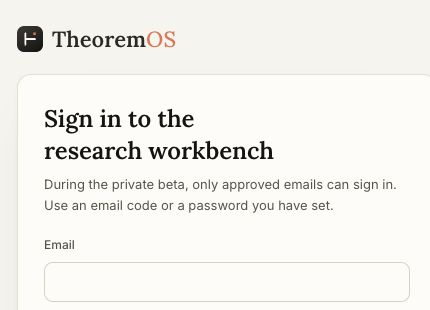

# 线上工作台版本与体验独立审查

> PR 范围：本提交归档 2026-11-03 的审查结果、证据和修改/测试建议；不包含产品修复。下文“未提交/推送”等描述指原审查阶段。源码引用固定在审查基线，不能代表后续 main 或线上版本。

审查日期：2026-11-03，America/Los_Angeles。源码基准：`main = 8261c178ed9f379831606b154c41fbdecca94d57`。

**结论：公开工作台资源可达，但当前浏览器会话未登录，登录后的线上体验验收未完成。线上构建含 main 中没有的聊天与形式化入口，部署源码、服务端及 worker 版本仍无法确定。不能用 main 的队列实现解释线上双任务故障，也不能把历史 `formalization_token_limit` 当成本次复现。**

本报告独立于主审查及本地 Web 测试任务。已阅读仓库 AGENTS.md 和原始开源前审查要求；只读取源码、公开网页与公开构建资源，新增本报告及其证据附件。未切换分支、修改产品代码、提交、部署、发起真实模型任务、发送登录邮件、创建账号或读取凭据。

审查网址：[https://app.theoremos.top/](https://app.theoremos.top/)。以下观察均为记录时点的证据，不保证此后部署保持不变。

## 1. 证据范围与版本对应

采用四类证据：**本次浏览器观察**、**本次公开资源静态核对**、**main 源码确认**、**历史转述**。后两类均不自动代表当前线上行为。

| 编号 | 证据与结果 | 能支持的结论与边界 |
| --- | --- | --- |
| E1 | 本次 `git rev-parse HEAD main origin/main` 三者均为指定提交；初始 `git status --short` 为空；`git worktree list` 只有当前 main 工作树 | 代码行号均属于固定 main；本次没有重新联网核对 origin/main 是否更新 |
| E2 | 主审查交接记录称已核对远程分支，并检索本地 origin 分支和可达历史；本次确认 `out/release-review/branch-entry-search.txt`、`history-entry-search.txt` 均为 0 字节，又在 main 的 apps/docs/scripts/tests 检索四个入口标识，未命中 | 远程分支核对属于继承证据；空日志本身不证明搜索过程完整。主审查最终记录为 45 个 origin 分支（排除 origin/HEAD）及本地 `--all` 可达历史，未找到可确认部署候选，故以固定 main 为源码基准；空搜索日志未随本 PR 发布 |
| E3 | Chrome 首次打开工作台出现 `ERR_CONNECTION_CLOSED`；之后普通 HTTP GET 返回 200、TLS 校验结果为 0；浏览器重载成功，短暂出现工作台壳层与 “Connecting”，随后跳转 `/login.html` | 首次连接失败已观察到，**持续宕机未成立**；不同访问路径和时间结果不同，未定位网络原因；“Connecting”仅为本次短暂初始化状态 |
| E4 | 登录页显示内测邮箱限制、邮箱验证码/密码登录入口、图形验证码及帮助链接；没有输入账号、验证码或密码，没有发送表单 | 当前任务没有可用的已登录会话。没有进入历史、任务详情、取消或结果页面；不能推断其他会话是否仍登录 |
| E5 | 06:32:40–06:32:41 PST 读取根 HTML 和其引用的 `app.js`，均成功；JS 中出现 `formalize-form`、`formalize-original`、`formalize-start`、`?chat=` 和 `/api/formalizations` 字面量 | 当前公开客户端确有相应代码。只能确定客户端产物特征，不能证明后端路由可用、任务正确运行或部署对应哪个源码提交 |
| E6 | 原始要求记录旧会话“证明素数有无穷多个”的形式化失败详情只有 `formalization_token_limit` | 历史转述，本次未重新查看该记录，未复现，未核对该记录对应部署版本 |

公开资源采样指纹如下，完整的脱敏元数据见 [public-evidence.json](web-production/public-evidence.json)。只保留字节长度、摘要、标识命中数和观察说明，没有保存整份 HTML/JS、Cookie、认证头或真实账号信息。

| 资源 | 字节数 | SHA-256 |
| --- | ---: | --- |
| `https://app.theoremos.top/` | 46,513 | `c47180c0149762c55b0dcd060b66fd540381e679a55df069aa6c8db7b61e21e4` |
| `https://app.theoremos.top/app.js` | 1,548,645 | `cdaee6382d33596680e6ac1964fe3abaa78659a11ef592403a215ad3a42cba53` |

公开 JS 中四个入口标识的命中数依次为 1、3、1、2；HTML 本身均为 0。这说明仅搜索入口 HTML 会遗漏运行时渲染的入口。JS 片段包含表单渲染、发送按钮、聊天历史链接及形式化能力查询，但本次没有把压缩代码片段当作完整源码审查。

本次检查没有取得 commit/buildId/commitSha 或 sourcemap 指向；响应 ETag 是资源标识，不能替代源码提交。这里的“没有取得”只限已检查的页面、产物与相关响应字段，并非证明系统所有位置都没有版本信息。没有枚举隐藏版本端点或请求 sourcemap。

main 的 [formalization.ts:8](https://github.com/LikC1606/theorem-os/blob/8261c178ed9f379831606b154c41fbdecca94d57/apps/web/client/formalization.ts#L8) 明确是 `formalize --phase report` 的离线对照页，载荷内嵌且不发起网络获取。因此，main 中存在“formalization”文件不能建立与线上聊天形式化流程的一一对应。**main 是本报告可审计的源码基准，线上公开 JS 是独立的产物证据。**

另一次 web 检索通道对工作台和官网均未能取回内容；后续本机 HTTP 与 Chrome 成功结果优先用于本报告的可达性判断。官网不属于本次体验验收范围。

## 2. 实际可观察体验与限制

本次观察只覆盖未登录入口。页面提供两种登录入口，邮件登录前有图形验证码；没有尝试解决验证码或查找凭据。初始页面曾显示中文，语言初始化后显示英文；本次没有据此认定语言缺陷。

以下裁剪图仅包含公开标题、内测说明与空邮箱框，已经人工查看，不含验证码、账号或会话信息。它只能证明登录入口布局，不能证明整个页面、移动端或登录后的体验质量。



| 体验项目 | 本次状态 |
| --- | --- |
| 公开壳层、登录重定向、登录页布局 | 已观察；首访连接失败，重载后成功 |
| 新建任务输入、发送后反馈、保留草稿 | 未观察；不提交任务 |
| 历史切换、形式化阶段、证明阶段、错误详情 | 未观察；登录阻塞 |
| 取消、预算耗尽、成功结果及独立验收凭据 | 未观察；无当前任务证据 |
| 双标签页、刷新恢复、断线重连的任务一致性 | 未验证；页面重载仅验证公开入口恢复 |
| 真实 Lean、Linux 容器、网关额度和两任务同时运行 | 未执行；只读范围不包含真实模型任务 |

本次没有执行本地构建、单元测试或浏览器 mock 测试；这些属于另一独立审查。本文不引用其他任务尚未交付的结果，也不把源码阅读写成测试通过。

## 3. main 中可复用的进度与隔离能力

以下均为源码确认，**尚未证明当前部署复用了相同实现**。

| 能力 | 精确位置 | 对体验方案的含义 |
| --- | --- | --- |
| 默认并发 1、队列容量默认 8 | [config.ts:97](https://github.com/LikC1606/theorem-os/blob/8261c178ed9f379831606b154c41fbdecca94d57/apps/web/config.ts#L97) | 默认串行本身不等于拒绝第二个任务；线上参数未知 |
| 按 run.id 保存 Job；每个新 Job 独立 AbortController；读写核对 owner | [jobs.ts:57](https://github.com/LikC1606/theorem-os/blob/8261c178ed9f379831606b154c41fbdecca94d57/apps/web/jobs.ts#L57)、[jobs.ts:91](https://github.com/LikC1606/theorem-os/blob/8261c178ed9f379831606b154c41fbdecca94d57/apps/web/jobs.ts#L91)、[jobs.ts:103](https://github.com/LikC1606/theorem-os/blob/8261c178ed9f379831606b154c41fbdecca94d57/apps/web/jobs.ts#L103) | main 已有任务隔离基础，仍需交错测试，不能由静态结构宣告所有竞态安全 |
| 容量检查、队满反馈、FIFO 调度与排队位置 | [jobs.ts:78](https://github.com/LikC1606/theorem-os/blob/8261c178ed9f379831606b154c41fbdecca94d57/apps/web/jobs.ts#L78)、[jobs.ts:276](https://github.com/LikC1606/theorem-os/blob/8261c178ed9f379831606b154c41fbdecca94d57/apps/web/jobs.ts#L276) | `queueLimit` 在此统计运行中加排队总数；消息声称草稿保留仍需前端验证；不应只把并发改为 2 |
| 重启读取保存记录，未结束任务标为 interrupted | [jobs.ts:44](https://github.com/LikC1606/theorem-os/blob/8261c178ed9f379831606b154c41fbdecca94d57/apps/web/jobs.ts#L44) | 可说明“保留记录，未恢复执行”；不能承诺服务重启自动续跑 |
| 每个 run 的事件 sequence、at、type、message；最多保留 200 条；阶段时刻和 progressAt 单独保留 | [jobs.ts:261](https://github.com/LikC1606/theorem-os/blob/8261c178ed9f379831606b154c41fbdecca94d57/apps/web/jobs.ts#L261)、[shared.ts:88](https://github.com/LikC1606/theorem-os/blob/8261c178ed9f379831606b154c41fbdecca94d57/apps/web/shared.ts#L88) | 复用现有事件；event 身份应组合 run.id 与 sequence。事件轮转后不应伪装成完整日志 |
| 按 owner 推送 runs-changed 版本通知；20 秒 SSE 保活 | [server.ts:436](https://github.com/LikC1606/theorem-os/blob/8261c178ed9f379831606b154c41fbdecca94d57/apps/web/server.ts#L436)、[runUpdates.ts:7](https://github.com/LikC1606/theorem-os/blob/8261c178ed9f379831606b154c41fbdecca94d57/apps/web/client/runUpdates.ts#L7) | SSE 是列表失效通知，不是完整事件重放协议；重连应重新取快照，不能把 keep-alive 当作数学进展 |
| 连接代际、列表请求代际、观察 sequence 防旧数据覆盖，按 webRunId 定位 | [app.ts:1663](https://github.com/LikC1606/theorem-os/blob/8261c178ed9f379831606b154c41fbdecca94d57/apps/web/client/app.ts#L1663)、[app.ts:1691](https://github.com/LikC1606/theorem-os/blob/8261c178ed9f379831606b154c41fbdecca94d57/apps/web/client/app.ts#L1691) | 可沿现有同步机制补测试，避免另建不一致的状态机 |
| 阶段状态、阶段用时、预算信息、断线提示 | [RunHeader.tsx:8](https://github.com/LikC1606/theorem-os/blob/8261c178ed9f379831606b154c41fbdecca94d57/apps/web/client/ui/RunHeader.tsx#L8)、[RunHeader.tsx:69](https://github.com/LikC1606/theorem-os/blob/8261c178ed9f379831606b154c41fbdecca94d57/apps/web/client/ui/RunHeader.tsx#L69)、[app.ts:1676](https://github.com/LikC1606/theorem-os/blob/8261c178ed9f379831606b154c41fbdecca94d57/apps/web/client/app.ts#L1676) | 顶部状态条已有基础；形式化阶段需由真实部署事件接入 |
| 研究前沿、已记录检查数量、独立验收状态、路线图 | [researchProgressView.tsx:43](https://github.com/LikC1606/theorem-os/blob/8261c178ed9f379831606b154c41fbdecca94d57/apps/web/client/researchProgressView.tsx#L43)、[ProgressSummary.tsx:24](https://github.com/LikC1606/theorem-os/blob/8261c178ed9f379831606b154c41fbdecca94d57/apps/web/client/ui/ProgressSummary.tsx#L24)、[ResearchRoadmap.tsx:8](https://github.com/LikC1606/theorem-os/blob/8261c178ed9f379831606b154c41fbdecca94d57/apps/web/client/ui/ResearchRoadmap.tsx#L8) | 已明确局部闭合不代表原题通过；保留这个边界，不把 Agent 完成或形式化通过显示为证明成功 |
| 研究事件和常见模型失败的用户文案、30 秒 worker 心跳限频 | [progress.ts:4](https://github.com/LikC1606/theorem-os/blob/8261c178ed9f379831606b154c41fbdecca94d57/apps/web/progress.ts#L4)、[progress.ts:80](https://github.com/LikC1606/theorem-os/blob/8261c178ed9f379831606b154c41fbdecca94d57/apps/web/progress.ts#L80)、[progress.ts:150](https://github.com/LikC1606/theorem-os/blob/8261c178ed9f379831606b154c41fbdecca94d57/apps/web/progress.ts#L150) | 复用诊断分类；本次在 main 的 apps/docs/scripts/tests 未找到精确的 `formalization_token_limit`，不能断言线上错误已获相同翻译 |

## 4. 发现及最小处理

| 优先级 / 编号 | 影响、证据与置信度 | 最小处理、验收及预计工作量 |
| --- | --- | --- |
| P1 / WEB-01 线上源码归属未闭合 | E1、E2、E5；线上入口与 main 不对应的证据强，具体部署 commit 未知。影响归因、复现与回滚核对；这是发布证据缺口，尚非已证实产品故障 | 由部署负责人提供前端/服务端/worker 对应提交或构建清单、公开资源摘要及镜像 digest；允许三者版本不同。若有未提交补丁，提供脱敏源码快照及摘要。核对到本次产物后再定位修复文件。资料准备约 1–2h；回滚到已记录的上一发布版本 |
| P1 / WEB-02 线上关键交互未验收 | E4；确定本次未登录，不能判断双任务、错误、恢复是否达标。首次连接失败后来恢复，不列为持续宕机 | 在用户提供的已授权会话中只读核查历史；交错动作在隔离、可控 runner 的部署等价环境执行。全矩阵约 4–8h，问题修复另估；登录资料不进入报告或截图 |
| P1 / WEB-03 双任务容量与形式化→证明交接证据缺失 | main 默认串行且有队列；线上 bundle 有另一条形式化 API 路径。没有证据证明线上形式化队列、证明队列、账号限制、网关容量及交接关系 | 提供脱敏有效容量配置及一对任务的阶段/时间/关联 ID 轨迹；验证下节矩阵。先定义排队语义再调整容量；仅改 `THEOREMOS_WEB_CONCURRENCY=2` 不构成修复或验收 |
| P2 / WEB-04 历史错误反馈疑似过薄，现版待核对 | E6 是旧观察；历史只有错误码，缺少下一步；不能将其升级为现版确定缺陷，也不能推断 token 上限来源 | 先读取当前版本同类历史详情，随后用 fixture 触发同一结构化错误，落实“阶段、原因、保留成果、下一步、诊断编号”。部署源码确认后约 2–4h；若现版仍仅显示错误码，升为本轮 P1 体验修复 |

没有发现足以在本任务范围内宣布“证明接受错误”或“跨账号泄露”的 P0 事实。**缺少复现不等于相关风险已排除。**

## 5. 双任务验收矩阵（本次全部未执行）

统一先决条件：部署源码/配置可追溯；隔离环境使用可控制延迟、错误、事件顺序的 fake runner；任务 A/B 使用固定非敏感命题和独立 ID。记录 conversation → formalization → proof run → attempt 的实际关联及冻结 source/problem 身份，不预设线上已有这些字段。每项保存脱敏步骤、预期/实际、时间和相关事件。真实模型回归需另获明确授权和预算，本次不发起。

| 场景 | 可重复步骤 | 通过条件 |
| --- | --- | --- |
| A/B 都在形式化 | 阻塞 A 的生成步骤，提交 B，再按 B→A 顺序释放 | A 运行时可提交 B；各自状态独立；单容量明确排队，双容量确有执行时间重叠 |
| A 证明中、B 形式化 | 让 A 完成形式化并进入证明，保持运行，再提交 B | B 不覆盖 A；配置允许时继续形式化；交接只创建自己的证明 run，携带正确的冻结输入 |
| A/B 都证明 | 分别在总容量 1 与 2 下运行可控 worker | 容量 1 时 B 排队并显示位置；容量 2 且资源允许时两者同时推进；分别核对全局/账号/网关限制 |
| 切换与迟到回调 | A→B→A 切换，最后送达 B 的旧响应 | 当前详情不被另一任务污染；每个 run 的事件只更新自身；重复事件不重复展示 |
| 刷新/重连/乱序 | 在不同阶段刷新，断开事件连接，再补发重复、乱序通知 | 从持久化快照恢复关联；状态不倒退；断线及最后更新时间可见；缺失历史明确说明 |
| 双标签页 | 同账号两个标签分别查看 A/B | 订阅、选择、草稿和取消互不误伤；两页最终收敛同一任务事实 |
| 取消 B | A 活跃时取消排队 B；再测运行 B | 只 B 终止；A 继续；容量释放；B 的迟到进度不复活已取消状态 |
| A 失败 | 注入 A 的预算/网络失败，释放 B | A 有明确终态和原因；B 不被全局 busy 卡住，调度继续 |
| 队满保留草稿 | 填满容量后提交包含非敏感标记的 B | 反馈容量与下一步；草稿可恢复；无虚假的已创建记录 |
| 重复提交 | 双击发送并模拟提交响应延迟/重试 | 同一次提交只创建一项；恢复或重试行为有服务端幂等证据 |
| 账号隔离 | 仅在授权本地环境用两个测试账号访问对方的任务/事件 | 列表、详情、取消、SSE/轮询、导出均拒绝越权，不泄露内容；线上不做侵入性验证 |
| 形式化交接失败/恢复 | 固定形式化候选后让证明入队失败，再执行支持的恢复动作 | 候选和原题关联保留，错误阶段明确；恢复不重复创建或绑定到另一会话 |

上述矩阵应分别标注浏览器 fixture、真实服务调度、真实 worker 三层覆盖，不能用浏览器 mock 通过替代部署或 Linux worker 通过。

## 6. 48 小时可交付的进度与错误方案

以下是待实现/核验的草图，不是线上截图。复用 main 的 RunHeader、事件列表、ResearchProgressView 和 ResearchRoadmap；必须先把实际部署事件对齐，避免另造状态机。

```text
任务 B · 形式化 / Lean 编译       本阶段用时 00:42
连接：在线 · 最后活动：12 秒前 · 最近通过检查：尚无

06:40:01  本任务已进入队列                 [详情]
06:40:05  开始生成形式化候选               [候选 Lean]
06:40:22  Lean 编译未通过，正在修复         [编译诊断]
06:40:35  已生成修订候选                   [候选变化]

结果证据：形式化未通过 / 局部证明未检查 / 完整原题尚未验收
```

| 真实状态或事件 | 用户文案与显示规则 |
| --- | --- |
| queued | 已排队，前方 N 项；仅在存在真实队列数据时显示计数 |
| preparing / dependency_check | 正在准备独立环境 / 检查 Lean 依赖 |
| 形式化生成、编译、语义核对 | 分别显示阶段与用时；线上事件名和实际边界待源码确认，不虚构 main 已接入 |
| 实际存在的等待批准 | 等待你确认，并说明等待对象；main 的 plan_approval_requested 是研究计划批准，不能直接当作形式化确认 |
| turn_started / proof_check_started / 修复事件 | 正在构造候选 / 检查候选 / 修复候选；允许回退与循环 |
| evaluation_started / evaluation_finished | 正在独立验收完整原题 / 展示验收报告结论；事件结束或模型“完成”本身不等于通过 |
| cancelled / interrupted / error / budget stopped | 分开显示取消、服务中断、失败和预算停止，保留已验证成果的准确状态 |
| worker_activity / SSE keep-alive | 仅表示运行或连接活跃；不要增加证明完成计数 |

未知总工作量时只显示阶段、不定进度和真实用时；真实分母存在时才显示“已检查 3/5 项”，不要换算成原题完成百分比。动画遵守 reduced-motion，阶段用文本和 aria 状态表达，错误可键盘访问。

数据契约优先复用 `run.id + event.sequence`、`event.at`、`phase`、`updatedAt`、`progressAt`。部署形式化链路需核对或补充：conversationId、formalizationId、proofRunId、attemptId 的关联，事件稳定身份与状态、阶段开始时间、lastActivityAt、结构化 errorCode/diagnosticId、可访问产物引用，以及 retry/resume/cancel 的能力标记。若将嵌套事件扁平化推送，必须携带归属 ID；不要求把所有字段重复写入已有嵌套结构。每个任务维持自己的请求、草稿和订阅上下文。

main 当前事件只保留最近 200 条；重连以快照补齐当前状态，若需要更早活动，需已有归档或明确的截断提示，不能宣称完整重放。

对于历史错误码，建议文案为：

> **形式化已停止：达到本次生成用量上限。** 当前形式化尚未完成；保留成果以实际记录为准。可查看已保存的候选或诊断。诊断编号：由服务端提供。若尚无候选，应明确“未保存可用候选”。

用量上限的来源要根据实际错误分类确认，不能把所有 token/配额/基础设施问题都归因于题目。仅当后端明确支持时提供“重试”“继续”或“调整预算”；否则提供复制脱敏诊断和文档入口。诊断不包含密钥、账号或隐藏思维链。必须区分“形式化通过”“局部引理通过”“完整原题独立验收通过”。

## 7. 最小补证据与后续时间安排

无需提供密钥、Cookie 或原始 HAR。以下四项足以启动下一轮有针对性的验收：

1. 部署负责人给出前端、API、worker 的源码提交/快照及构建产物关联；以本次公开 JS 摘要作核对起点。
2. 用户在可访问的浏览器会话中自行完成授权登录，或提供脱敏的当前版本历史任务页与结构化事件导出；历史资料应注明发生时版本，不能用旧页面代替现版。
3. 实际有效的形式化/证明并发、全局与单账号队列上限、worker 资源、网关并发额度，仅配置数值与来源层级，不含凭据。
4. 隔离的部署等价环境与可控 runner，至少一对 A/B 的全链路事件及终态报告；真实模型验证若必要，另行明确预算及范围。

| 时间窗 | 依赖与产出 | 验收/回退 |
| --- | --- | --- |
| 0–6h | 部署负责人闭合版本和容量；恢复已授权只读访问；约 2–3h 有效工作 | 当前产物与源码能关联，读到至少一条现版历史详情。资料未齐则收窄发布声明，不猜根因 |
| 6–24h | 开发/测试在部署等价环境完成矩阵重点项；约 4–8h | 容量 1/2、取消、失败、刷新、交接均有日志；发现问题先定位真实源码。暂不提高生产并发 |
| 24–36h | 依现版差距补阶段、断线、错误文案；约 4–6h | fixture 覆盖乱序与终态，按钮仅显示已实现能力；回退只撤体验改动，保留原有验收证据 |
| 36–48h | 约 3–4h 回归与发布演练，预留余量 | 核对发布版本、当前授权会话只读历史、脱敏截图和回滚版本；真实 worker 缺口仍明确列出，不借 mock 结果销项 |

工作量是假设版本和环境能及时提供的估计，不包含未知故障修复。不存在要求本轮删除代码的证据；版本追踪、任务隔离验收和错误可理解性比结构重写更直接。

## 8. 发布判断

| 发布对象 | 本任务判断 | 条件 |
| --- | --- | --- |
| 源码公开准备 | **Conditional Go（仅就线上/源码对应关系）** | 清楚声明 main 是审查基准、线上实现未建立对应；不能宣称公开源码可复现当前全部在线功能。许可证、安全与其他发布门槛由主报告决定，本任务未验收 |
| 开发者从零运行 | **本任务未验证，不能给出 Go** | 本地独立审查应给出构建、首次运行、Linux worker 的实际结果；本报告的源码阅读不替代这些证据 |
| 线上服务体验 | **No-Go：尚不满足“已完成线上体验验收”的放行条件** | 这是关键证据和登录后验收缺失的判断，不是断言服务不可用。满足版本关联、授权历史核对及双任务矩阵后重评；若降级为受限 research preview，须明确排队容量及未验证功能，不能承诺并发或自动恢复 |

本次已确认公开资源可达及客户端入口与 main 的差异；当前版本的任务进度、历史错误质量、并发根因和真实证明执行仍需上述补证据。首次连接错误及历史 token 错误均未被扩大为已稳定复现的现版故障。
